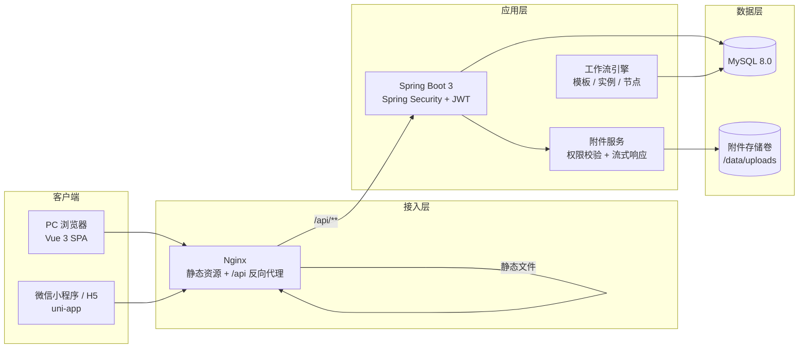
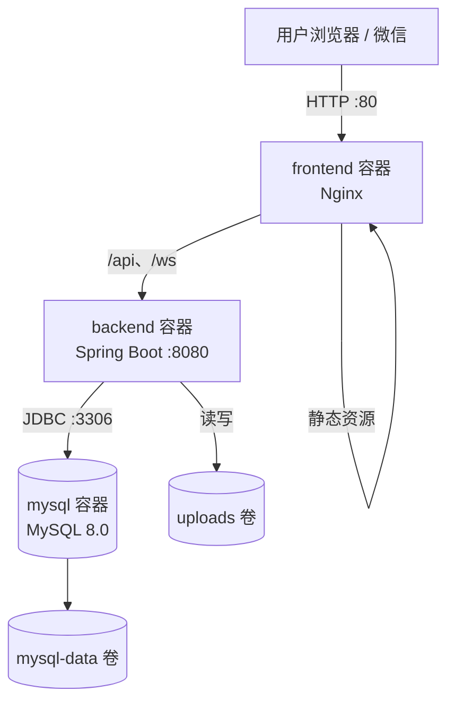
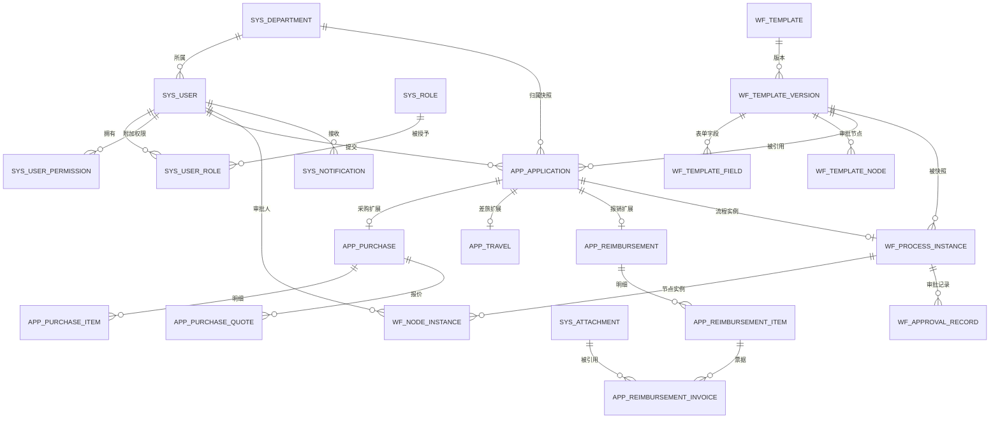
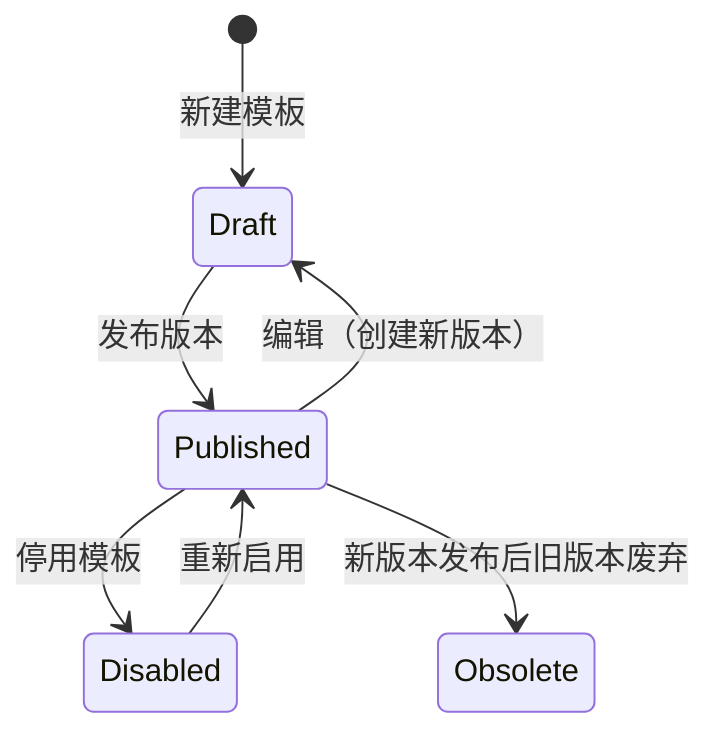
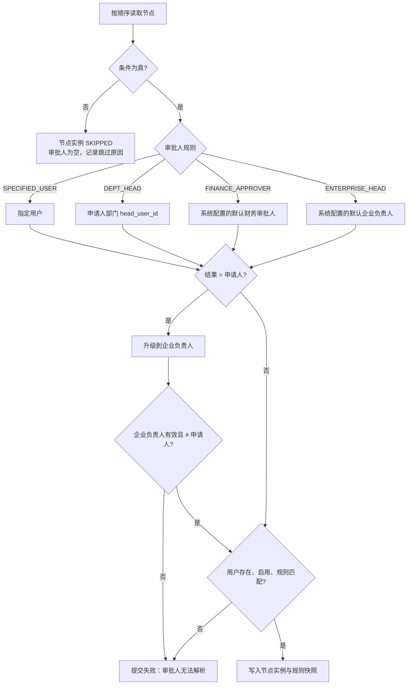
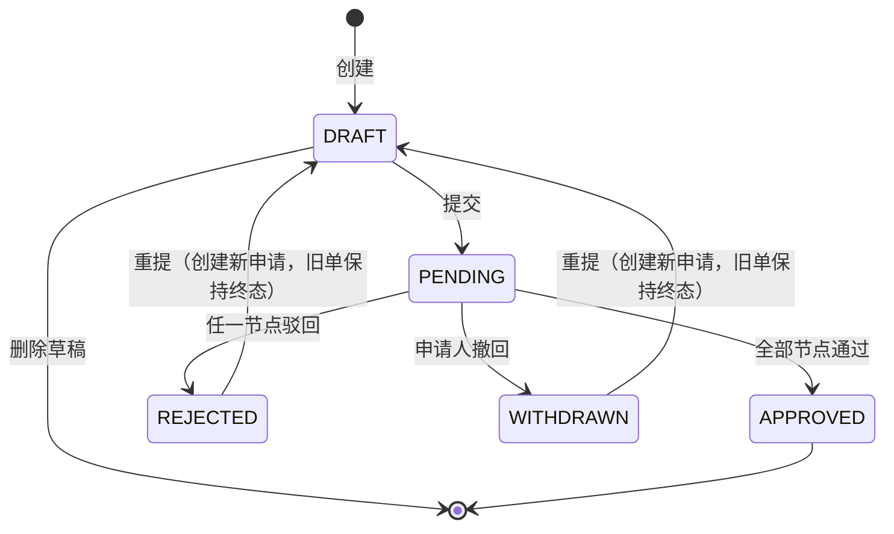

# 企业审批系统 设计文档

> **历史版本，已被替代。** 本文保留 2026-10-20 的 v0.5 正文，仅用于历史检索，不再作为实现依据。
> 最新依据为[中期设计文档-修订版.pdf](<midterm/中期设计文档-修订版.pdf>)（与交付的优化版字节一致）；开发从[规格入口](<../specs/001-enterprise-approval/README.md>)开始。
> 本文中的 JWT、WebSocket、模板升级/归档迁移等旧方案已被持久不透明会话、前台轮询、复制填写确认等最新版规则取代；具体见[差异分析](<../specs/001-enterprise-approval/gap-analysis.md>)。旧测试编号也不替代最新版 T01—T22。

**《BS 体系软件设计》期末大程**

| 项目 | 内容 |
|---|---|
| 课程名称 | BS 体系软件设计 |
| 项目名称 | 企业审批系统 |
| 文档版本 | v0.5（复核修订稿） |
| 编写日期 | 2026-10-20 |
| 姓名 | ＿＿＿＿＿＿＿＿ |
| 学号 | ＿＿＿＿＿＿＿＿ |
| 指导教师 | ＿＿＿＿＿＿＿＿ |

## 修订记录

| 版本 | 日期 | 作者 | 修订说明 |
|---|---|---|---|
| v0.1 | 2026-10-20 |  | 初稿：需求分析、总体设计、数据库与详细设计 |
| v0.2 | 2026-10-20 |  | 根据内部设计核验意见修订：预期版本并发控制、草稿 JSON 模型与编号、采购/报销字段补齐、线上报价截图、模板升级策略、草稿可见性、审批人有效性、权限管理闭环、附件归属与重提、JWT 撤销、WebSocket 票据、种子数据、物理删除、备份恢复、独立报销说明、小程序 HTTPS，并补充测试用例与性能验证 |
| v0.3 | 2026-10-20 |  | 根据 v0.2 复核意见修订：提交 UPDATE 与 CHECK 对齐、实际节点分配作为独立授权、文件元数据与磁盘清理分离、停用覆盖 PENDING/WAITING、mysqldump 权限参数、AI 约束边界表述、草稿保存/附件/升级纳入版本控制、重提走模板迁移预览、财务/企业统计与正文授权拆分，并同步测试与备份命令 |
| v0.4 | 2026-10-20 |  | 根据 v0.3 复核意见修订：升级归档值随申请保存并统一鉴权、补齐部门负责人查看条件、拆分文件删除失败与事务回滚测试、备份采用独立目录与完成标记，并同步接口、审计、保留策略和需求追踪 |
| v0.5 | 2026-10-20 |  | 明确负责人任命与角色同步、停用前交接及改派规则；保护升级归档引用的附件；同步用户保留策略、统计接口权限和归档页面交互，增加 T-58、T-59 |

## 目录

1. 项目概述
2. 需求分析
3. 总体设计
4. 数据库设计
5. 接口设计
6. 详细设计
7. 安全设计
8. 界面设计
9. 测试方案
10. 部署方案
11. 项目计划
12. 风险与应对
13. 需求追踪矩阵
14. 附录

---

## 1 项目概述

### 1.1 项目背景与目标

本项目是《BS 体系软件设计》课程的期末大程，目标是独立开发一个可运行的企业审批 Web 应用，覆盖**采购审批、差旅申请、报销审批**三类固定业务，以及**管理员自定义的其他审批流程**。系统通过多部门、不同权限的用户演示"申请提交 → 逐级审批 → 结果查询 → 操作留痕"的完整过程。

系统需满足以下总体目标：

- 业务数据全部持久化到数据库，刷新页面、重启服务后不丢失；
- 所有权限检查在服务端执行，前端隐藏按钮不作为权限控制手段；
- 审批流程支持模板化、版本化，提交后的人员与规则快照不可被后续配置变更改写；
- 提供可复现的 Docker 部署方案、初始化数据与演示账号；
- 在完成基础功能的前提下，实现移动端与实时提醒等提分功能。

### 1.2 建设范围

| 范围 | 任务书要求 | 本项目安排 |
|---|---|---|
| 基础必做 | 用户与部门权限；三类业务审批；可配置的第四类流程；审批状态与历史；查询统计；附件管理；数据库与部署；文档及演示 | 全部纳入本期（P0） |
| 重点提分 | 移动端完成全部核心操作、界面适配，以及审批进度变化提醒 | 纳入本期（P1）：基于 uni-app 实现**微信小程序为主**（H5 作为辅助演示），并按 10.5 配置 HTTPS/WSS 与合法域名 |
| 可选增强 | 会签、委托、催办、OCR、重复票据预警、流程可视化等 | 核心功能完成后按进度实现"审批委托及超时催办""跨申请重复票据预警"（P2） |

### 1.3 术语与缩略语

| 术语 | 说明 |
|---|---|
| 申请单（Application） | 用户发起的一次业务请求，包括采购、差旅、报销和自定义流程 |
| 模板（Template） | 一类审批流程的配置，包含表单字段和审批节点 |
| 模板版本（Template Version） | 模板的一次发布快照；已发布版本不可修改，只能发布新版本 |
| 流程实例（Process Instance） | 某张申请单提交后产生的审批执行实例 |
| 节点实例（Node Instance） | 流程实例中的一个审批节点，绑定唯一实际审批人 |
| 快照（Snapshot） | 提交时固化的审批路径、规则口径和人员信息 |
| 数据范围（Data Scope） | 角色可访问的数据边界，如本人、本部门、财务授权范围、全公司 |
| RBAC | 基于角色的访问控制（Role-Based Access Control） |

### 1.4 参考资料

- 《BS 体系软件设计》期末大程任务书
- 课程课件：B/S 体系概述、HTML/CSS/JavaScript、前后端分离与 Web 开发
- Spring Boot、Spring Security、MyBatis-Plus、Vue 3、Element Plus 官方文档
- OWASP Top 10（2021）

### 1.5 项目约束与交付要求

| 约束 | 内容 |
|---|---|
| 完成方式 | 独立完成 |
| 任务书原文 | "本功能模块实现不能使用 AI 辅助编程。"（"管理员自定义审批流程"一节） |
| 实施边界（作者解释） | 该约束适用于实现"管理员自定义审批流程"功能的代码：凡实现自定义模板、字段、节点配置、动态表单解析与流程执行的代码，均按实际功能纳入该模块，不能仅以代码目录或"通用引擎"命名划分边界；与自定义流程无关的模块不受此限制。实施时单独排期并保留独立完成证据（开发日志、git 提交记录等） |
| 代码管理 | 程序代码使用 git 管理；提交物包含 git 信息（如 `git log`） |
| 时间节点 | 设计文档：**2026 年 11 月 16 日**前提交，占最终总成绩 20%；最终交付：**2027 年 1 月 3 日前**（任务书原文） |
| 交付物 | 程序代码、实验报告（含任务书后附封面）、设计文档、其他文档（使用手册、测试报告、开发体会/小结）、Docker 容器与配置、功能演示视频、git 日志信息；打包上传学在浙大或发送至任务书指定邮箱 |
| 移动端 | 提分项要求"小程序或独立 App"；H5 仅作为辅助演示，不单独作为该项验收依据（见 10.5） |

---

## 2 需求分析

### 2.1 用户角色与数据范围

系统设置五类角色。一个用户可以兼任多个角色，角色与数据访问范围在用户详情中明确展示。

| 角色 | 代码 | 主要操作 | 数据范围与限制 |
|---|---|---|---|
| 普通员工 | EMPLOYEE | 提交三类业务及自定义申请；查看进度；撤回允许撤回的申请；处理被指定为审批人的节点 | 查看本人申请、被指定审批的申请及必要附件；不能查看其他员工的无关申请 |
| 部门负责人 | DEPT_HEAD | 处理本部门分配给自己的审批任务；查询本部门已提交申请情况 | 只能处理当前节点的本人待办；只能查看本部门已提交申请，不得查看他人草稿；不能因部门负责人身份跨部门查看全部数据 |
| 财务审批人 | FINANCE_APPROVER | 处理预算审查、报销财务审核等指定节点 | 查看分配给自己的业务；按 `STAT_FINANCE` 做授权财务统计；不因财务角色自动获得全部流程权限 |
| 企业负责人 | ENTERPRISE_HEAD | 处理高金额或特定流程的审批任务 | 查看分配给自己及必要附件；企业范围正文查询需 `BUSINESS_VIEW` 授权，企业统计需 `STAT_ENTERPRISE` |
| 系统管理员 | SYS_ADMIN | 管理部门、用户、角色、流程模板及系统配置 | 管理身份本身不授予业务查看或审批权限；本人申请与实际节点分配按业务规则访问，扩大查看范围须另行授权；授权和管理变更需留痕 |

**实际节点分配是独立授权来源：** 任何启用用户被模板指定为某节点审批人（包括 SPECIFIED_USER、DEPT_HEAD、FINANCE_APPROVER、ENTERPRISE_HEAD 解析结果）后，节点进入 PENDING 或已处理时可查看该申请详情及审批所需附件；节点处于 PENDING 且非自审时可执行审批，WAITING 阶段不授予查看。该授权仅覆盖被分配的这一张申请，不因角色为普通员工而失效，也不扩大到其他申请。

**权限基本要求：**

1. 权限检查必须在服务端执行，覆盖列表、详情、审批、附件预览和下载等接口。仅隐藏前端按钮不视为完成权限控制。
2. 不能通过修改请求中的申请人、部门、金额、审批人或角色字段获取额外权限。非当前审批人不能操作待办节点。
3. 审批权限与数据查看权限分离：能在列表看到某条数据，不代表能查看其全部正文或下载附件。

### 2.2 功能需求

#### 2.2.1 账户与通用界面（FR-A）

| 编号 | 需求 |
|---|---|
| FR-A1 | 提供注册、登录、退出、个人信息查看与修改功能 |
| FR-A2 | 注册填写用户名、姓名、邮箱、密码及申请加入的部门；用户名和邮箱全局唯一；前后端均校验 |
| FR-A3 | 注册用户默认处于"待确认"状态，由管理员确认并授予部门与角色后才能正常使用 |
| FR-A4 | 提供我的申请、我的待办、已办事项、通知中心等入口；管理员拥有独立的管理入口 |
| FR-A5 | 申请支持保存草稿、校验后提交、查看详情、查看当前审批人与历史进度 |
| FR-A6 | 列表支持按类型、状态、时间、关键词筛选并分页 |
| FR-A7 | 显示加载中、空数据、校验错误、提交成功、操作失败等状态；删除、撤回等操作需二次确认 |
| FR-A8 | 申请编号由系统生成且唯一；申请人、部门、操作时间由服务端确定 |
| FR-A9 | 已提交记录与审批日志在刷新页面、重启服务后仍可查询 |

#### 2.2.2 用户、部门与权限管理（FR-B）

| 编号 | 需求 |
|---|---|
| FR-B1 | 至少设置研发部、市场部、财务部三个部门；部门信息由管理员维护 |
| FR-B2 | 一个用户可兼任多个角色；角色、部门和数据访问范围清晰可见 |
| FR-B3 | 部门归属及高权限角色（部门负责人、财务审批人、企业负责人）由管理员确认和授予，客户端不能自行指定 |
| FR-B4 | 密码不少于 8 个字符，使用框架支持的密码哈希方式存储，不得保存明文密码 |
| FR-B5 | 管理员可审核注册申请、停用/启用用户、重置密码、授予或撤销角色；所有变更留痕 |
| FR-B6 | 服务器端对每个接口执行身份认证与权限校验，并校验数据归属 |

#### 2.2.3 采购审批（FR-C）

| 编号 | 需求 |
|---|---|
| FR-C1 | 采购申请包含标题、采购原因、期望到货日期、所属部门或项目、预算上限、备注 |
| FR-C2 | 包含可增删的多条采购明细：物品或服务名称、规格、数量、单位、预计单价、金额；界面至少支持两条明细的输入与增删（提交时至少一条有效明细） |
| FR-C3 | 报价比较：至少两家供应商的名称、报价日期、报价金额或明细、报价附件或依据；线上购买需提供购买链接和截图 |
| FR-C4 | 采购选择：拟选供应商、选择理由、预计采购总额；未选最低价时必须说明理由 |
| FR-C5 | 无法提供两家报价时，允许填写单一来源采购说明，并在审批界面明显标识 |
| FR-C6 | 报价由人工录入，不要求实时抓取电商价格 |

#### 2.2.4 差旅申请（FR-D）

| 编号 | 需求 |
|---|---|
| FR-D1 | 差旅申请包含目的地、出发地、开始时间、结束时间、出差目的、同行人员、交通方式、费用预算及补充附件 |
| FR-D2 | 结束时间不得早于开始时间；预算不得为负数 |
| FR-D3 | 出差天数或时长由系统计算，并说明采用自然日还是实际时长口径 |
| FR-D4 | 显示待审批、已批准、已驳回、已撤回等进度 |
| FR-D5 | 已批准的差旅可在报销时被选择关联，报销详情中展示对应差旅信息 |

#### 2.2.5 报销审批（FR-E）

| 编号 | 需求 |
|---|---|
| FR-E1 | 报销单包含标题、报销说明、报销人及部门、关联申请、提交时间、备注、系统计算的合计金额 |
| FR-E2 | 费用明细包含类型、发生日期、用途说明、金额；至少支持三条明细，可新增、修改和删除 |
| FR-E3 | 费用类型由管理员维护或采用明确的预设列表 |
| FR-E4 | 每条明细关联一个或多个票据文件；票据号码可选，保留文件名、上传人、上传时间等信息 |
| FR-E5 | 合计金额等于有效费用明细金额之和；客户端展示即时合计，服务端提交时重新计算 |
| FR-E6 | 金额采用整数分或精确小数处理，不使用浮点数决定审批路径 |
| FR-E7 | 明细金额必须大于零，日期和类型必须有效，空明细不能提交 |
| FR-E8 | 同一张报销单内不能重复使用同一票据记录；跨单重复检测作为增强项 |
| FR-E9 | 默认每条明细至少有一份票据；无票支出应提供明确的例外选项及原因，并在财务审核界面突出显示 |
| FR-E10 | 票据至少支持 JPEG、PNG、PDF；单文件建议不超过 10MB，限制文件数量和总大小；预览或下载需校验当前用户对该报销单的访问权限 |

#### 2.2.6 管理员自定义审批流程（FR-F）

| 编号 | 需求 |
|---|---|
| FR-F1 | 管理员可通过管理界面创建、编辑、启用和停用审批模板 |
| FR-F2 | 员工能使用已启用的模板提交申请；至少提供一种采购、差旅、报销之外的流程（如请假、用章、设备借用） |
| FR-F3 | 不能通过修改代码、直接改数据库或复制固定页面的方式实现自定义流程 |
| FR-F4 | 模板包含名称、说明、适用部门、版本和启用状态 |
| FR-F5 | 表单至少支持单行文本、多行文本、数字或金额、日期、单选及附件字段；可设置名称、是否必填和必要的校验规则 |
| FR-F6 | 支持配置不少于两个顺序审批节点，可调整节点顺序；每个节点配置名称及审批人规则 |
| FR-F7 | 审批人规则至少支持"指定用户"和"申请人所在部门负责人"两种 |
| FR-F8 | 发布前校验字段标识唯一、条件引用有效、节点完整及审批人规则有效，并避免形成循环 |
| FR-F9 | 支持模板版本与流程实例：已发布版本不可修改，历史实例继续按旧版本执行 |

> **开发约束（任务书原文）**：本功能模块实现不能使用 AI 辅助编程。该约束适用于实现本模块功能的代码（包括自定义模板、字段、节点配置、动态表单解析与流程执行）；与自定义流程无关的模块不受影响。实施安排见 1.5 与第 11 章，验收追踪见第 13 章。

#### 2.2.7 审批流转、查询与提醒（FR-G、FR-H、FR-I）

| 编号 | 需求 |
|---|---|
| FR-G1 | 申请状态包括草稿、审批中、已通过、已驳回、已撤回；各状态的可执行操作符合任务书状态表 |
| FR-G2 | 提交时保存本次审批路径、规则口径和人员快照；后续阈值或人员配置变化不得自动改写已有实例 |
| FR-G3 | 每个有效节点确定一名实际审批人；前一节点通过前，不允许处理后续节点 |
| FR-G4 | 驳回必须填写理由，驳回后结束本次审批；申请人在审批中可撤回；撤回与审批并发时只允许一方成功（审批/撤回请求携带预期版本，见 6.3.6） |
| FR-G5 | 任何人不得审批自己的申请 |
| FR-G6 | 重复点击、网络重试或两个浏览器同时审批，不能产生两次有效流转 |
| FR-G7 | 审批日志至少记录申请及版本、节点、操作人、动作、意见、时间、结果；普通用户不得修改或删除审批日志 |
| FR-H1 | 提供持久的站内通知：新待办、申请通过、驳回、撤回时通知相关用户 |
| FR-H2 | 通知支持未读数量、标记已读、跳转详情；同一次业务变化不能因请求重试生成重复通知 |
| FR-H3 | 非当前用户的通知不得被读取或标记 |
| FR-I1 | 提供个人申请和待办统计；部门负责人可按权限查看本部门各类申请数量、状态分布和审批通过金额 |
| FR-I2 | 统计口径明确：例如按提交时间统计已通过申请金额，草稿和驳回金额不计入已通过金额 |
| FR-I3 | 至少提供一种图表或直观的统计展示 |

#### 2.2.8 附件与票据（FR-J）

| 编号 | 需求 |
|---|---|
| FR-J1 | 附件统一上传、预览、下载；文件与业务单据关联 |
| FR-J2 | 仅允许 JPEG、PNG、PDF；单文件不超过 10MB；限制单申请文件数与总大小 |
| FR-J3 | 附件预览、下载均校验当前用户对所属申请单的访问权限 |
| FR-J4 | 保存原始文件名、存储路径、文件类型、大小、上传人、上传时间和 SHA-256 摘要 |

#### 2.2.9 移动端与实时提醒（FR-K，提分项）

| 编号 | 需求 |
|---|---|
| FR-K1 | 采用小程序或独立 App（本项目选择基于 uni-app 的微信小程序为主，H5 作为辅助演示） |
| FR-K2 | 手机上可完成注册登录、三类业务及自定义申请填写提交、拍照或选择票据上传、审批操作、进度查询和通知查看 |
| FR-K3 | 适配主流手机屏幕；表单、日期输入、金额输入、按钮和多行明细便于触控；正文不依赖横向滚动；表格改为卡片或分步展示 |
| FR-K4 | 实际状态变化产生提醒：手机页面打开时自动显示待办或结果变化，无需手动刷新；点击提醒可进入有权限的申请详情 |
| FR-K5 | 可选邮件、Web Push 或 App 推送之一，在页面关闭或后台时触达；拒绝通知权限或发送失败时，站内通知仍可查 |

#### 2.2.10 可选增强功能（FR-L）

| 编号 | 功能 | 优先级 |
|---|---|---|
| FR-L1 | 多人会签或或签 | P2 |
| FR-L2 | 审批委托及超时催办 | P2 |
| FR-L3 | 可视化流程编辑 | P2 |
| FR-L4 | 跨申请重复票据预警 | P2 |
| FR-L5 | OCR 识别票据并由用户确认 | P3（视进度） |

> 本期承诺完成 P0 全部功能与 P1 移动端；P2 功能在核心功能稳定后按剩余时间实现，并在最终文档中如实说明完成范围。

### 2.3 非功能需求

| 类别 | 要求 |
|---|---|
| 安全 | 服务端鉴权；密码哈希；防越权（IDOR）、SQL 注入、XSS、路径穿越；上传类型白名单；敏感操作留痕 |
| 性能 | **自定目标（非任务书硬性指标）**：50 并发用户下，列表/详情接口 P95 响应时间 ≤ 1s，提交/审批 ≤ 2s；支持 ≥ 10 万条申请数据的分页查询；验证方法与环境见 9.4 |
| 可靠性 | 关键写操作使用数据库事务；审批、撤回、通知具备幂等性；服务重启数据不丢失 |
| 兼容性 | PC 端支持 Chrome/Edge 最新两个大版本；移动端适配 375–430px 宽度及微信小程序 |
| 可用性 | 关键操作有明确的状态反馈与二次确认；表单错误定位到字段；空状态有引导 |
| 可维护性 | 前后端分层；数据库变更通过 Flyway 管理；提供 OpenAPI 文档；核心逻辑有自动化测试 |
| 可部署性 | 一条 `docker compose up -d` 启动前端、后端、数据库；初始化数据可重复执行 |
| 合规性 | 审批日志只增不改；管理员授权与配置变更留痕；演示数据不含真实个人信息 |

### 2.4 关键业务规则汇总

| 编号 | 规则 | 设计落点 |
|---|---|---|
| R-01 | 所有权限检查在服务端执行 | 6.1 权限服务；5.1 统一鉴权 |
| R-02 | 密码 ≥ 8 位，加盐哈希，不存明文 | 7.3 BCrypt |
| R-03 | 注册用户默认待确认，部门和高权限角色由管理员授予 | 6.1.2 注册与审核 |
| R-04 | 申请编号、申请人、部门、时间由服务端确定 | 6.2.1 申请编号与快照 |
| R-05 | 提交时固化审批路径、规则口径和人员快照 | 6.3.4 审批人解析与快照 |
| R-06 | 每节点一名实际审批人，前序节点通过后才能处理后续节点 | 6.3.5 状态机 |
| R-07 | 不得审批自己的申请 | 6.3.4 审批人自审规避 |
| R-08 | 驳回必须填理由并结束流程；撤回与审批并发只有一方成功 | 6.3.6 并发控制 |
| R-09 | 重复点击/重试/双浏览器不得产生两次有效流转 | 6.3.6 幂等设计 |
| R-10 | 审批日志只增不改，普通用户不可修改删除 | 6.7 审计 |
| R-11 | 金额使用精确小数，服务端重算合计 | 6.2.5 金额规则 |
| R-12 | 同一报销单内票据不得重复使用 | 4.3 唯一约束 + 6.4 |
| R-13 | 通知持久化、去重、按用户隔离 | 6.5 通知中心 |
| R-14 | 已发布模板版本不可修改；模板停用不影响运行中实例 | 6.3.1 模板版本 |
| R-15 | 管理员管理权限 ≠ 审批权限；查看业务正文需额外授权 | 6.1.3 权限矩阵 |
| R-16 | 草稿不占用申请编号；提交事务内生成唯一编号，申请编号与状态满足 CHECK 约束 | 4.3.3、6.2.1 |
| R-17 | 草稿仅申请人可见；部门/财务/企业/管理范围均不得读取他人草稿 | 6.1.3 资源可见性矩阵 |
| R-18 | 审批、驳回、撤回、转办必须携带预期版本；版本不符返回 40901 | 6.3.6 并发控制 |
| R-19 | 重提时复制附件与文件，新申请拥有独立附件，旧申请历史不受影响 | 6.3.7、6.4 |
| R-20 | 独立报销（无关联差旅/采购）必须填写报销说明 | 6.2.5 |

---

## 3 总体设计

### 3.1 系统架构

系统采用前后端分离架构。PC 端与移动端共用同一套 REST API；Nginx 负责静态资源与反向代理；Spring Boot 提供 API；MySQL 持久化业务数据；附件保存在服务器本地卷中，通过受控接口访问。



**分层说明：**

| 层次 | 职责 |
|---|---|
| 表现层（Vue / uni-app） | 页面渲染、表单交互、客户端校验、状态提示；不承担安全决策 |
| 接入层（Nginx） | 托管前端静态资源；将 `/api` 代理到后端；限制上传体积；设置安全响应头 |
| 应用层（Spring Boot） | 认证授权、业务规则、工作流编排、事务与幂等、审计与通知 |
| 数据层（MySQL + 文件卷） | 业务数据、流程数据、通知与审计；附件二进制文件 |

### 3.2 技术选型

| 层次 | 技术 | 选型理由 |
|---|---|---|
| 后端语言 | Java 17（LTS） | 课程主流技术栈；长期支持；生态成熟 |
| 后端框架 | Spring Boot 3.x | 快速构建 REST API；与 Spring Security、事务、校验集成完善 |
| 安全 | Spring Security 6 + JWT（jjwt） | 无状态认证，适合前后端分离与移动端；便于统一鉴权 |
| 持久层 | MyBatis-Plus 3.5.x | SQL 可控，便于统计查询与分页；减少样板代码 |
| 数据库 | MySQL 8.0 | 事务、约束、JSON 字段、窗口函数满足统计需求；Docker 部署成熟 |
| 数据库迁移 | Flyway | 建表与种子数据版本化、可重复执行，满足"初始化数据可复现"要求 |
| 接口文档 | springdoc-openapi | 自动生成 OpenAPI 文档，便于联调与验收 |
| 前端 | Vue 3 + TypeScript + Vite | 组合式 API、类型安全、构建快；课程讲授的主流方案 |
| UI 组件 | Element Plus 2.x | 表格、表单、日期、上传、弹窗组件齐全 |
| 前端状态与路由 | Pinia + Vue Router | 轻量、官方推荐 |
| 图表 | ECharts 5 | 状态分布、金额趋势等统计可视化 |
| 移动端 | uni-app（Vue 3） | 一套代码编译到微信小程序与 H5，复用 Vue 技术栈与 API |
| 实时提醒 | Spring WebSocket + STOMP；轮询兜底 | 页面打开时实时推送；断线或后台时轮询/重新拉取 |
| 部署 | Docker + Docker Compose + Nginx | 一键复现；满足任务书容器化要求 |
| 测试 | JUnit 5、Mockito、Spring Boot Test、Testcontainers（MySQL） | 单元、集成、并发与权限测试 |

### 3.3 模块划分

```
┌─────────────────────────────────────────────────────────┐
│                      前端（web / mobile）                │
│  认证 · 工作台 · 我的申请 · 新建申请 · 待办 · 通知 · 统计  │
│  管理员：用户/部门/角色 · 模板设计器 · 费用类型 · 审计日志   │
└───────────────────────────┬─────────────────────────────┘
                            │ REST / WebSocket
┌───────────────────────────▼─────────────────────────────┐
│                      后端（server）                       │
│  auth        认证、注册、登录、密码                         │
│  user        用户、部门、角色、授权                         │
│  application 申请主模型、采购/差旅/报销、草稿与提交          │
│  workflow    模板、版本、字段、节点、流程引擎、审批           │
│  attachment  上传、预览、下载、权限校验                     │
│  notification 站内通知、未读数、已读、WebSocket 推送         │
│  statistics  个人/部门/财务/企业统计                        │
│  audit       操作审计、审批日志                             │
│  common      统一响应、异常、校验、分页、工具                 │
└───────────────────────────┬─────────────────────────────┘
                            │
┌───────────────────────────▼─────────────────────────────┐
│                  MySQL 8.0 + 附件存储卷                    │
└─────────────────────────────────────────────────────────┘
```

**后端包结构建议：**

```
com.zju.bs
├── common          // Result、PageResult、异常、错误码、校验工具
├── config          // Security、WebMvc、Jackson、OpenAPI、WebSocket 配置
├── auth            // 注册、登录、JWT
├── user            // 用户、部门、角色、权限服务
├── application
│   ├── purchase
│   ├── travel
│   ├── reimbursement
│   └── custom
├── workflow        // 模板、版本、字段、节点、引擎、审批
├── attachment
├── notification
├── statistics
├── audit
└── admin           // 管理端聚合接口
```

### 3.4 关键设计决策

| 编号 | 决策 | 理由 |
|---|---|---|
| D-01 | **统一申请主表 + 业务扩展表**：`app_application` 保存公共字段与状态，采购/差旅/报销分别用扩展表保存专有字段 | 统一列表、筛选、审批、通知、统计逻辑；业务字段保持强类型与约束 |
| D-02 | **内置流程与自定义流程共用同一工作流引擎**：三类内置流程以只读种子模板存在，自定义模板由管理员创建 | 避免两套流程代码；内置流程同样享受版本化和快照能力；自定义流程无需改代码 |
| D-03 | **模板版本化 + 实例快照**：申请提交时复制审批路径、规则口径、解析后的审批人 | 后续人员、阈值、模板变更不影响运行中实例，满足任务书硬性要求 |
| D-04 | **服务端为唯一可信源**：申请编号、申请人、部门、时间、金额合计、审批人、状态流转全部由服务端计算 | 防止篡改请求字段越权或伪造数据 |
| D-05 | **金额用 `DECIMAL(14,2)` + Java `BigDecimal`** | 避免浮点误差；合计与阈值判断精确 |
| D-06 | **写操作幂等 + 条件更新 + 预期版本**：状态迁移使用带当前状态条件的 UPDATE，客户端必须携带 `expectedVersion`，配合行锁与唯一约束 | 重复点击、网络重试、并发审批不会产生重复流转；中间节点批准与撤回并发时也只有一方成功 |
| D-07 | **附件统一元数据 + 受控下载**：文件存放于 Web 根目录之外，下载走鉴权接口 | 防止未授权访问与路径穿越 |
| D-08 | **固定角色 + 数据范围**：角色为系统内置，权限在服务层集中判断 | 课程项目规模下易于验证；角色授予、模板与配置变更全部审计 |
| D-09 | **草稿以 JSON 快照保存，提交时落规范化业务表**：`app_application.draft_payload` 保存未校验的完整表单；提交成功后写入采购/差旅/报销扩展表 | 允许不完整草稿而无需把业务表所有列改为可空；提交时一次性做完整校验与事务写入 |
| D-10 | **模板版本升级显式确认**：草稿绑定创建时的模板版本；模板发布新版本后，旧草稿必须经"升级预览→用户确认"才能提交 | 避免模板字段增删导致静默丢数据或漏填新必填项 |

### 3.5 部署架构



Docker Compose 包含三个服务：`mysql`、`backend`、`frontend`。数据库与附件使用命名卷持久化；后端通过环境变量读取数据库连接、JWT 密钥、上传目录等配置；前端 Nginx 托管构建产物并反向代理 API。默认本地演示使用 HTTP :80；小程序真机/体验版需配置 HTTPS/WSS 与合法域名，见 10.5。

---

## 4 数据库设计

### 4.1 设计约定

| 项目 | 约定 |
|---|---|
| 字符集 | `utf8mb4`，排序规则 `utf8mb4_0900_ai_ci`；用户名、邮箱统一转小写存储 |
| 主键 | `BIGINT AUTO_INCREMENT`，无业务含义 |
| 金额 | `DECIMAL(14,2)`，单位元；Java 使用 `BigDecimal`，禁止 `double`/`float` |
| 时间 | `DATETIME(3)`，数据库与应用统一使用 `Asia/Shanghai`；接口使用 ISO-8601（带时区） |
| 枚举 | 数据库存 `TINYINT` 或短字符串，含义见 4.5 数据字典 |
| 外键 | 业务关联启用外键，默认 `ON DELETE RESTRICT`；票据使用复合外键保证明细、附件与报销单属于同一申请；历史与审计数据禁止物理删除 |
| 草稿模型 | 草稿的完整表单保存在 `app_application.draft_payload`（JSON），提交前不写业务扩展表；扩展表的 `NOT NULL` 约束仅在提交落库时生效 |
| 删除 | 草稿及其独占附件允许**物理删除**；已提交申请、审批记录、审计日志、通知不提供删除能力；不设业务表逻辑删除字段 |
| 审计字段 | 关键表包含 `created_at`、`updated_at`；审批日志、通知额外记录事件时间 |
| 并发控制 | 关键表包含 `lock_version`（乐观锁），状态迁移同时使用条件更新与行锁 |

**表名前缀：**

- `sys_`：系统与基础数据（用户、部门、角色、配置、附件、通知、审计）
- `wf_`：工作流（模板、版本、字段、节点、流程实例、节点实例、审批记录）
- `app_`：申请业务（申请主表、采购、差旅、报销及明细）

### 4.2 ER 图



### 4.3 表结构设计

#### 4.3.1 系统与基础数据表

**sys_department（部门）**

| 字段 | 类型 | 约束 | 说明 |
|---|---|---|---|
| id | BIGINT | PK, AUTO_INCREMENT | 部门 ID |
| code | VARCHAR(32) | NOT NULL, UNIQUE | 部门编码，如 RD/MKT/FIN/ADM/HR |
| name | VARCHAR(64) | NOT NULL, UNIQUE | 部门名称 |
| head_user_id | BIGINT | NULL, FK→sys_user(id) | 部门负责人；审批人解析依据；任命时同步维护 DEPT_HEAD 角色，已任命后不得通过清空关系绕过交接（6.1.2） |
| status | TINYINT | NOT NULL DEFAULT 1 | 1 启用，0 停用 |
| created_at | DATETIME(3) | NOT NULL | 创建时间 |
| updated_at | DATETIME(3) | NOT NULL | 更新时间 |

> `sys_user.department_id` 与 `sys_department.head_user_id` 构成循环引用，建表时先建表后加外键，或允许 `head_user_id` 无外键约束由服务层保证一致性。本项目采用"先建表、后补外键"的迁移顺序。

**sys_user（用户）**

| 字段 | 类型 | 约束 | 说明 |
|---|---|---|---|
| id | BIGINT | PK, AUTO_INCREMENT | 用户 ID |
| username | VARCHAR(32) | NOT NULL, UNIQUE | 登录名，小写，4–20 位字母/数字/下划线 |
| password_hash | VARCHAR(100) | NOT NULL | BCrypt 哈希 |
| real_name | VARCHAR(32) | NOT NULL | 姓名 |
| email | VARCHAR(128) | NOT NULL, UNIQUE | 邮箱，小写 |
| department_id | BIGINT | NULL, FK→sys_department(id) | 所属部门；待确认用户可为空 |
| status | TINYINT | NOT NULL DEFAULT 0 | 0 待确认，1 正常，2 停用 |
| avatar_path | VARCHAR(255) | NULL | 头像存储路径 |
| last_login_at | DATETIME(3) | NULL | 最近登录时间 |
| token_version | INT | NOT NULL DEFAULT 0 | 认证版本；改密/管理员重置密码时 +1，旧令牌立即失效 |
| lock_version | INT | NOT NULL DEFAULT 0 | 业务乐观锁（与 token_version 分离） |
| created_at | DATETIME(3) | NOT NULL | 创建时间 |
| updated_at | DATETIME(3) | NOT NULL | 更新时间 |

索引：`idx_user_department (department_id)`、`idx_user_status (status)`。

**sys_role（角色）**

| 字段 | 类型 | 约束 | 说明 |
|---|---|---|---|
| id | BIGINT | PK | 角色 ID |
| code | VARCHAR(32) | NOT NULL, UNIQUE | EMPLOYEE/DEPT_HEAD/FINANCE_APPROVER/ENTERPRISE_HEAD/SYS_ADMIN |
| name | VARCHAR(64) | NOT NULL | 角色名称 |
| data_scope | VARCHAR(16) | NOT NULL | SELF/DEPT/FINANCE/ENTERPRISE/ADMIN |
| description | VARCHAR(255) | NULL | 说明 |

> `data_scope` 是角色的默认数据边界标签；实际 SQL 过滤条件由 6.1.3 的资源可见性矩阵与 `sys_user_permission.scope_json` 共同决定，不能仅凭角色标签放行。

**sys_user_role（用户角色）**

| 字段 | 类型 | 约束 | 说明 |
|---|---|---|---|
| user_id | BIGINT | PK, FK→sys_user(id) | 用户 |
| role_id | BIGINT | PK, FK→sys_role(id) | 角色 |
| granted_by | BIGINT | NOT NULL | 授予人 |
| granted_at | DATETIME(3) | NOT NULL | 授予时间 |

**sys_user_permission（用户附加权限）**

| 字段 | 类型 | 约束 | 说明 |
|---|---|---|---|
| user_id | BIGINT | PK, FK→sys_user(id) | 用户 |
| permission_code | VARCHAR(64) | PK | 权限编码：`BUSINESS_VIEW`（查看业务正文与票据）、`STAT_FINANCE`（独立财务统计）、`STAT_ENTERPRISE`（独立企业统计） |
| scope_json | JSON | NULL | 授权范围：`BUSINESS_VIEW` 可限定部门/业务类型或 ALL；`STAT_FINANCE` 可配置可统计的部门与业务类型；`STAT_ENTERPRISE` 可配置全公司或指定部门 |
| granted_by | BIGINT | NOT NULL | 授予人 |
| granted_at | DATETIME(3) | NOT NULL | 授予时间 |
| reason | VARCHAR(255) | NULL | 授权原因 |

> 该表用于实现任务书要求的"管理员查看业务正文和票据须另行授权""企业范围查询能力必须明确授权"。权限的查询、授予、撤销通过管理端接口完成，所有变更写入审计日志。

**sys_token_revocation（令牌撤销记录）**

| 字段 | 类型 | 约束 | 说明 |
|---|---|---|---|
| jti | CHAR(36) | PK | JWT 唯一标识 |
| user_id | BIGINT | NOT NULL, FK→sys_user(id) | 用户 |
| expires_at | DATETIME(3) | NOT NULL | 原令牌到期时间 |
| revoked_at | DATETIME(3) | NOT NULL | 撤销时间 |
| reason | VARCHAR(32) | NOT NULL | LOGOUT/PASSWORD_CHANGE/ADMIN_RESET |

索引：`idx_token_expire (expires_at)`；定时任务清理已过期记录。该表使退出登录在服务重启后仍然有效。

**sys_ws_ticket（WebSocket 一次性连接票据）**

| 字段 | 类型 | 约束 | 说明 |
|---|---|---|---|
| id | BIGINT | PK | 票据 ID |
| ticket_hash | CHAR(64) | NOT NULL, UNIQUE | 票据的 SHA-256（不存明文） |
| user_id | BIGINT | NOT NULL, FK→sys_user(id) | 用户 |
| expires_at | DATETIME(3) | NOT NULL | 过期时间（签发后 30 秒） |
| used_at | DATETIME(3) | NULL | 使用时间；非空表示已使用 |
| created_at | DATETIME(3) | NOT NULL | 签发时间 |

索引：`idx_ws_ticket_expire (expires_at)`。票据一次性使用，避免把 JWT 放入 WebSocket URL。

**sys_file_cleanup（文件清理任务）**

| 字段 | 类型 | 约束 | 说明 |
|---|---|---|---|
| id | BIGINT | PK | 任务 ID |
| application_id | BIGINT | NULL | 关联申请（便于排查） |
| stored_path | VARCHAR(512) | NOT NULL | 待删除的相对路径 |
| reason | VARCHAR(32) | NOT NULL | DRAFT_DELETE/ATTACHMENT_REMOVE/FAILED_UPLOAD/FAILED_COPY |
| status | TINYINT | NOT NULL DEFAULT 0 | 0 待处理，1 已完成，2 失败 |
| attempts | INT | NOT NULL DEFAULT 0 | 重试次数 |
| last_error | VARCHAR(255) | NULL | 最近错误 |
| created_at | DATETIME(3) | NOT NULL | 创建时间 |
| updated_at | DATETIME(3) | NOT NULL | 更新时间 |

索引：`idx_cleanup_status (status, created_at)`。文件删除与数据库事务解耦：元数据删除与任务记录同事务提交，事务提交后由清理器删除文件；失败按退避策略重试。元数据已删除后即使文件暂存，也无法通过接口访问。

**sys_config（系统配置）**

| 字段 | 类型 | 约束 | 说明 |
|---|---|---|---|
| config_key | VARCHAR(64) | PK | 配置键 |
| config_value | VARCHAR(512) | NOT NULL | 配置值 |
| value_type | VARCHAR(16) | NOT NULL | STRING/NUMBER/BOOLEAN/USER_ID |
| description | VARCHAR(255) | NULL | 说明 |
| updated_by | BIGINT | NULL | 修改人 |
| updated_at | DATETIME(3) | NOT NULL | 修改时间 |

主要配置项：采购/报销企业负责人审批阈值、差旅企业负责人阈值与天数阈值、默认财务审批人、默认企业负责人。

**sys_sequence（申请编号序列）**

| 字段 | 类型 | 约束 | 说明 |
|---|---|---|---|
| seq_key | VARCHAR(32) | PK | 如 `PO:20261020` |
| current_value | BIGINT | NOT NULL DEFAULT 0 | 当前序号 |
| updated_at | DATETIME(3) | NOT NULL | 更新时间 |

> 生成编号时在事务内 `SELECT ... FOR UPDATE` 并自增，保证并发下唯一、连续。

**sys_expense_type（费用类型字典）**

| 字段 | 类型 | 约束 | 说明 |
|---|---|---|---|
| id | BIGINT | PK | 类型 ID |
| code | VARCHAR(32) | NOT NULL, UNIQUE | 编码 |
| name | VARCHAR(64) | NOT NULL | 名称，如交通/住宿/餐饮/办公/其他 |
| enabled | TINYINT | NOT NULL DEFAULT 1 | 是否启用 |
| sort_order | INT | NOT NULL DEFAULT 0 | 排序 |
| created_at | DATETIME(3) | NOT NULL | 创建时间 |

**sys_attachment（附件）**

| 字段 | 类型 | 约束 | 说明 |
|---|---|---|---|
| id | BIGINT | PK | 附件 ID |
| application_id | BIGINT | NOT NULL, FK→app_application(id) | 所属申请；上传前必须先创建草稿 |
| biz_type | VARCHAR(24) | NOT NULL | GENERAL/QUOTE/QUOTE_SCREENSHOT/TRAVEL/INVOICE/CUSTOM_FIELD |
| original_name | VARCHAR(255) | NOT NULL | 原始文件名 |
| stored_path | VARCHAR(512) | NOT NULL | 相对存储路径，如 `2026/10/uuid.pdf` |
| content_type | VARCHAR(64) | NOT NULL | MIME 类型 |
| size_bytes | BIGINT | NOT NULL | 文件大小 |
| sha256 | CHAR(64) | NOT NULL | 内容摘要，用于重复票据预警 |
| uploader_id | BIGINT | NOT NULL, FK→sys_user(id) | 上传人 |
| created_at | DATETIME(3) | NOT NULL | 上传时间 |

索引：`idx_attachment_app (application_id)`、`idx_attachment_sha (sha256)`；唯一约束 `uk_attachment_app_id (application_id, id)` 供票据复合外键引用。

**sys_notification（站内通知）**

| 字段 | 类型 | 约束 | 说明 |
|---|---|---|---|
| id | BIGINT | PK | 通知 ID |
| user_id | BIGINT | NOT NULL, FK→sys_user(id) | 接收人 |
| type | VARCHAR(24) | NOT NULL | TODO/APPROVED/REJECTED/WITHDRAWN/TRANSFERRED/SYSTEM |
| title | VARCHAR(128) | NOT NULL | 标题 |
| content | VARCHAR(512) | NOT NULL | 内容摘要 |
| application_id | BIGINT | NULL | 关联申请，用于跳转 |
| event_key | VARCHAR(128) | NOT NULL, UNIQUE | 业务事件唯一键，用于去重 |
| read_at | DATETIME(3) | NULL | 已读时间 |
| created_at | DATETIME(3) | NOT NULL | 创建时间 |

索引：`idx_notification_user (user_id, read_at, created_at)`。

**sys_audit_log（操作审计日志）**

| 字段 | 类型 | 约束 | 说明 |
|---|---|---|---|
| id | BIGINT | PK | 日志 ID |
| actor_id | BIGINT | NOT NULL | 操作人 |
| action | VARCHAR(64) | NOT NULL | 动作，如 GRANT_ROLE/UPDATE_TEMPLATE/UPDATE_CONFIG |
| target_type | VARCHAR(32) | NOT NULL | 目标类型 |
| target_id | BIGINT | NULL | 目标 ID |
| before_json | JSON | NULL | 变更前的管理元数据；不存申请正文、归档字段实际值或附件内容 |
| after_json | JSON | NULL | 变更后的管理元数据；不存申请正文、归档字段实际值或附件内容 |
| reason | VARCHAR(255) | NULL | 原因 |
| ip | VARCHAR(45) | NULL | 来源 IP |
| user_agent | VARCHAR(255) | NULL | 客户端 |
| created_at | DATETIME(3) | NOT NULL | 时间 |

索引：`idx_audit_actor (actor_id, created_at)`、`idx_audit_target (target_type, target_id)`。

#### 4.3.2 工作流表

**wf_template（审批模板）**

| 字段 | 类型 | 约束 | 说明 |
|---|---|---|---|
| id | BIGINT | PK | 模板 ID |
| code | VARCHAR(32) | NOT NULL, UNIQUE | 模板编码 |
| name | VARCHAR(64) | NOT NULL | 模板名称 |
| biz_type | VARCHAR(16) | NOT NULL | PURCHASE/TRAVEL/REIMBURSEMENT/CUSTOM |
| description | VARCHAR(512) | NULL | 说明 |
| scope_department_id | BIGINT | NULL, FK→sys_department(id) | 适用部门；NULL 表示全公司 |
| built_in | TINYINT | NOT NULL DEFAULT 0 | 1 内置只读，0 管理员自定义 |
| status | TINYINT | NOT NULL DEFAULT 0 | 0 停用，1 启用 |
| current_version_id | BIGINT | NULL | 当前发布版本 |
| created_by | BIGINT | NOT NULL | 创建人 |
| created_at | DATETIME(3) | NOT NULL | 创建时间 |
| updated_at | DATETIME(3) | NOT NULL | 更新时间 |

**wf_template_version（模板版本）**

| 字段 | 类型 | 约束 | 说明 |
|---|---|---|---|
| id | BIGINT | PK | 版本 ID |
| template_id | BIGINT | NOT NULL, FK→wf_template(id) | 模板 |
| version_no | INT | NOT NULL | 版本号，从 1 递增 |
| status | TINYINT | NOT NULL | 0 草稿，1 已发布，2 已废弃 |
| change_note | VARCHAR(512) | NULL | 变更说明 |
| published_by | BIGINT | NULL | 发布人 |
| published_at | DATETIME(3) | NULL | 发布时间 |
| created_at | DATETIME(3) | NOT NULL | 创建时间 |

唯一约束：`uk_version (template_id, version_no)`。

**wf_template_field（模板表单字段）**

| 字段 | 类型 | 约束 | 说明 |
|---|---|---|---|
| id | BIGINT | PK | 字段 ID |
| version_id | BIGINT | NOT NULL, FK→wf_template_version(id) | 所属版本 |
| field_key | VARCHAR(64) | NOT NULL | 字段标识，版本内唯一 |
| label | VARCHAR(64) | NOT NULL | 显示名称 |
| field_type | VARCHAR(16) | NOT NULL | TEXT/TEXTAREA/NUMBER/AMOUNT/DATE/SELECT/ATTACHMENT |
| required | TINYINT | NOT NULL DEFAULT 0 | 是否必填 |
| sort_order | INT | NOT NULL | 排序 |
| validation_json | JSON | NULL | 校验规则：min/max/regex/maxLength/options/maxFiles/maxSize |
| placeholder | VARCHAR(128) | NULL | 输入提示 |

唯一约束：`uk_field (version_id, field_key)`、`uk_field_order (version_id, sort_order)`。

**wf_template_node（模板审批节点）**

| 字段 | 类型 | 约束 | 说明 |
|---|---|---|---|
| id | BIGINT | PK | 节点 ID |
| version_id | BIGINT | NOT NULL, FK→wf_template_version(id) | 所属版本 |
| sort_order | INT | NOT NULL | 节点顺序 |
| name | VARCHAR(64) | NOT NULL | 节点名称 |
| approver_rule_type | VARCHAR(24) | NOT NULL | SPECIFIED_USER/DEPT_HEAD/FINANCE_APPROVER/ENTERPRISE_HEAD |
| approver_user_id | BIGINT | NULL | 指定用户；规则为 SPECIFIED_USER 时必填 |
| condition_expr | VARCHAR(512) | NULL | 条件表达式；为空表示必定执行 |

唯一约束：`uk_node_order (version_id, sort_order)`。

> 会签/或签作为增强项时，可增加 `wf_template_node_approver` 关联表；本期每个节点只解析一名实际审批人。

#### 4.3.3 申请业务表

**app_application（申请主表）**

| 字段 | 类型 | 约束 | 说明 |
|---|---|---|---|
| id | BIGINT | PK | 申请 ID |
| application_no | VARCHAR(32) | NULL, UNIQUE | 申请编号；草稿为 NULL，提交事务内生成，提交后非空 |
| biz_type | VARCHAR(16) | NOT NULL | PURCHASE/TRAVEL/REIMBURSEMENT/CUSTOM |
| template_version_id | BIGINT | NOT NULL, FK→wf_template_version(id) | 草稿绑定的模板版本；提交时按 6.3.1 的升级策略校验 |
| applicant_id | BIGINT | NOT NULL, FK→sys_user(id) | 申请人 |
| department_id | BIGINT | NOT NULL, FK→sys_department(id) | 提交时的申请人部门快照（提交时按当前部门重写） |
| title | VARCHAR(128) | NULL | 标题；草稿可为 NULL（界面显示"未命名草稿"），提交时必须非空 |
| remark | VARCHAR(512) | NULL | 备注（采购/差旅/报销通用） |
| status | TINYINT | NOT NULL DEFAULT 0 | 0 草稿，1 审批中，2 已通过，3 已驳回，4 已撤回 |
| total_amount | DECIMAL(14,2) | NULL | 采购总额/报销合计/差旅预算 |
| form_data | JSON | NULL | 自定义流程提交后的表单值；内置流程为 NULL |
| draft_payload | JSON | NULL | 草稿完整表单快照（含明细与附件 ID）；提交成功后清空 |
| form_archive | JSON | NULL | 模板升级时按批次追加的归档字段值；仅服务端写入，提交后保留，读取按所属申请正文权限校验 |
| root_id | BIGINT | NULL | 重提链的首个申请 ID |
| revision | INT | NOT NULL DEFAULT 1 | 版本号，重提时递增 |
| previous_id | BIGINT | NULL | 上一版本申请 ID |
| submitted_at | DATETIME(3) | NULL | 提交时间 |
| finished_at | DATETIME(3) | NULL | 结束时间 |
| lock_version | INT | NOT NULL DEFAULT 0 | 每次申请数据（草稿保存/附件增删/模板升级）或流程状态变更 +1；用于 `expectedVersion` 并发校验 |
| created_at | DATETIME(3) | NOT NULL | 创建时间 |
| updated_at | DATETIME(3) | NOT NULL | 更新时间 |

约束：`CHECK ((status = 0 AND application_no IS NULL AND submitted_at IS NULL) OR (status <> 0 AND application_no IS NOT NULL AND submitted_at IS NOT NULL AND title IS NOT NULL AND TRIM(title) <> ''))`，保证草稿无编号、提交后必有编号与标题。MySQL CHECK 按语句检查，因此状态、编号、提交时间、标题、部门快照、最终金额必须在**同一条 UPDATE** 中一起写入，不能依赖同一事务中的后续语句补齐。

索引：

- `idx_app_applicant_status (applicant_id, status)`
- `idx_app_dept_status_time (department_id, status, submitted_at)`
- `idx_app_type_status (biz_type, status)`
- `idx_app_submitted (submitted_at)`
- `idx_app_root (root_id)`

**app_purchase（采购扩展）**

| 字段 | 类型 | 约束 | 说明 |
|---|---|---|---|
| application_id | BIGINT | PK, FK→app_application(id) | 申请 |
| purchase_reason | VARCHAR(512) | NOT NULL | 采购原因/用途 |
| expected_arrival_date | DATE | NULL | 期望到货日期 |
| budget_limit | DECIMAL(14,2) | NOT NULL | 预算上限 |
| project_name | VARCHAR(128) | NULL | 所属项目 |
| selection_reason | VARCHAR(512) | NOT NULL | 选择理由 |
| selected_supplier | VARCHAR(128) | NOT NULL | 拟选供应商 |
| total_amount | DECIMAL(14,2) | NOT NULL | 预计采购总额 |
| lowest_price_flag | TINYINT | NOT NULL | 是否选择最低价 |
| no_lowest_reason | VARCHAR(512) | NULL | 未选最低价理由 |
| single_source_reason | VARCHAR(512) | NULL | 单一来源说明 |

**app_purchase_item（采购明细）**

| 字段 | 类型 | 约束 | 说明 |
|---|---|---|---|
| id | BIGINT | PK | 明细 ID |
| application_id | BIGINT | NOT NULL, FK→app_purchase(application_id) | 采购申请 |
| item_name | VARCHAR(128) | NOT NULL | 物品/服务名称 |
| spec | VARCHAR(128) | NULL | 规格 |
| quantity | DECIMAL(12,3) | NOT NULL | 数量，>0 |
| unit | VARCHAR(16) | NOT NULL | 单位 |
| unit_price | DECIMAL(14,2) | NOT NULL | 预计单价，≥0 |
| amount | DECIMAL(14,2) | NOT NULL | 金额 = round(数量×单价, 2) |
| sort_order | INT | NOT NULL | 排序 |

**app_purchase_quote（采购报价）**

| 字段 | 类型 | 约束 | 说明 |
|---|---|---|---|
| id | BIGINT | PK | 报价 ID |
| application_id | BIGINT | NOT NULL, FK→app_purchase(application_id) | 采购申请 |
| supplier_name | VARCHAR(128) | NOT NULL | 供应商名称 |
| quote_channel | VARCHAR(8) | NOT NULL | ONLINE 线上 / OFFLINE 线下 |
| quote_date | DATE | NOT NULL | 报价日期 |
| quote_amount | DECIMAL(14,2) | NOT NULL | 报价金额 |
| quote_detail | VARCHAR(512) | NULL | 报价明细；线下报价与附件二选一 |
| attachment_id | BIGINT | NULL, FK→(application_id, id) sys_attachment | 线下报价附件；线上报价必填（购买截图） |
| purchase_link | VARCHAR(512) | NULL | 线上购买链接；线上报价必填 |
| sort_order | INT | NOT NULL | 排序 |

约束：复合外键 `(application_id, attachment_id) → sys_attachment(application_id, id)`，保证报价附件属于同一申请。

**app_travel（差旅扩展）**

| 字段 | 类型 | 约束 | 说明 |
|---|---|---|---|
| application_id | BIGINT | PK, FK→app_application(id) | 申请 |
| departure_place | VARCHAR(64) | NOT NULL | 出发地 |
| destination | VARCHAR(64) | NOT NULL | 目的地 |
| start_time | DATETIME(3) | NOT NULL | 开始时间 |
| end_time | DATETIME(3) | NOT NULL | 结束时间 |
| purpose | VARCHAR(512) | NOT NULL | 出差目的 |
| companions | VARCHAR(255) | NULL | 同行人员（文本） |
| transport_mode | VARCHAR(32) | NOT NULL | 交通方式 |
| budget_amount | DECIMAL(14,2) | NOT NULL | 费用预算，≥0 |
| duration_days | INT | NOT NULL | 系统计算的自然日天数（起止同日计 1 天） |
| duration_basis | VARCHAR(32) | NOT NULL | 计算口径说明，如"自然日" |

约束：`CHECK (end_time >= start_time)`、`CHECK (budget_amount >= 0)`。

**app_reimbursement（报销扩展）**

| 字段 | 类型 | 约束 | 说明 |
|---|---|---|---|
| application_id | BIGINT | PK, FK→app_application(id) | 申请 |
| total_amount | DECIMAL(14,2) | NOT NULL | 系统计算的合计金额 |
| related_travel_id | BIGINT | NULL, FK→app_application(id) | 关联的已批准差旅 |
| related_purchase_id | BIGINT | NULL, FK→app_application(id) | 关联的已批准采购 |
| description | VARCHAR(512) | NULL | 报销说明；无关联差旅/采购时提交必填 |

**app_reimbursement_item（报销明细）**

| 字段 | 类型 | 约束 | 说明 |
|---|---|---|---|
| id | BIGINT | PK | 明细 ID |
| application_id | BIGINT | NOT NULL, FK→app_reimbursement(application_id) | 报销单 |
| expense_type_id | BIGINT | NOT NULL, FK→sys_expense_type(id) | 费用类型 |
| expense_date | DATE | NOT NULL | 发生日期 |
| description | VARCHAR(255) | NOT NULL | 用途说明 |
| amount | DECIMAL(14,2) | NOT NULL | 金额，>0 |
| invoice_exception | TINYINT | NOT NULL DEFAULT 0 | 是否无票支出 |
| exception_reason | VARCHAR(255) | NULL | 无票原因；无票时必填 |
| sort_order | INT | NOT NULL | 排序 |

唯一约束：`uk_item_app (id, application_id)` 供票据复合外键引用。

**app_reimbursement_invoice（报销票据关联）**

| 字段 | 类型 | 约束 | 说明 |
|---|---|---|---|
| id | BIGINT | PK | 关联 ID |
| application_id | BIGINT | NOT NULL, FK→app_reimbursement(application_id) | 报销单 |
| item_id | BIGINT | NOT NULL, 复合 FK→(id, application_id) app_reimbursement_item | 明细，必须属于同一报销单 |
| attachment_id | BIGINT | NOT NULL, 复合 FK→(application_id, id) sys_attachment | 附件，必须属于同一申请 |
| invoice_no | VARCHAR(64) | NULL | 票据号码（可选） |

唯一约束：

- `uk_invoice_item_attachment (item_id, attachment_id)`：同一明细不重复关联同一文件；
- `uk_invoice_app_attachment (application_id, attachment_id)`：同一报销单内不重复使用同一票据记录；
- `uk_invoice_app_no (application_id, invoice_no)`：同一报销单内票据号码不重复（`invoice_no` 为 NULL 时由 MySQL 唯一索引允许多行）。

复合外键：`(item_id, application_id) → app_reimbursement_item(id, application_id)`、`(application_id, attachment_id) → sys_attachment(application_id, id)`，由数据库层保证明细、附件与报销单属于同一申请；服务层在任何保存/提交入口仍执行同样的归属校验。

#### 4.3.4 工作流运行表

**wf_process_instance（流程实例）**

| 字段 | 类型 | 约束 | 说明 |
|---|---|---|---|
| id | BIGINT | PK | 实例 ID |
| application_id | BIGINT | NOT NULL, UNIQUE, FK→app_application(id) | 申请 |
| template_version_id | BIGINT | NOT NULL, FK→wf_template_version(id) | 提交时的模板版本快照 |
| status | TINYINT | NOT NULL | 0 运行中，1 已通过，2 已驳回，3 已撤回 |
| current_node_instance_id | BIGINT | NULL | 当前待处理节点 |
| path_snapshot | JSON | NOT NULL | 审批路径、条件求值结果（含跳过的节点及原因）、规则口径、解析后的审批人 |
| started_at | DATETIME(3) | NOT NULL | 开始时间 |
| finished_at | DATETIME(3) | NULL | 结束时间 |
| lock_version | INT | NOT NULL DEFAULT 0 | 乐观锁 |

**wf_node_instance（节点实例）**

| 字段 | 类型 | 约束 | 说明 |
|---|---|---|---|
| id | BIGINT | PK | 节点实例 ID |
| process_instance_id | BIGINT | NOT NULL, FK→wf_process_instance(id) | 流程实例 |
| node_index | INT | NOT NULL | 节点顺序 |
| node_name | VARCHAR(64) | NOT NULL | 节点名称快照 |
| approver_rule_type | VARCHAR(24) | NOT NULL | 审批人规则类型快照 |
| approver_user_id | BIGINT | NULL, FK→sys_user(id) | 实际审批人快照；条件跳过的节点为空 |
| rule_snapshot | JSON | NOT NULL | 规则来源、解析依据、升级原因等 |
| condition_expr | VARCHAR(512) | NULL | 条件表达式快照 |
| status | TINYINT | NOT NULL | 0 等待，1 待处理，2 已通过，3 已驳回，4 跳过，5 取消 |
| started_at | DATETIME(3) | NULL | 进入待处理时间 |
| finished_at | DATETIME(3) | NULL | 处理完成时间 |
| handled_by | BIGINT | NULL | 实际操作人（转办时与审批人不同） |
| lock_version | INT | NOT NULL DEFAULT 0 | 乐观锁 |

唯一约束：`uk_node_index (process_instance_id, node_index)`；索引：`idx_node_approver_status (approver_user_id, status)`。

**wf_approval_record（审批记录，只增不改）**

| 字段 | 类型 | 约束 | 说明 |
|---|---|---|---|
| id | BIGINT | PK | 记录 ID |
| application_id | BIGINT | NOT NULL, FK→app_application(id) | 申请 |
| process_instance_id | BIGINT | NOT NULL, FK→wf_process_instance(id) | 流程实例 |
| node_instance_id | BIGINT | NULL, FK→wf_node_instance(id) | 节点实例；提交/撤回记录可为空 |
| application_revision | INT | NOT NULL | 申请版本快照 |
| operator_id | BIGINT | NOT NULL | 操作人 |
| operator_name | VARCHAR(32) | NOT NULL | 操作人姓名快照 |
| action | VARCHAR(24) | NOT NULL | SUBMIT/APPROVE/REJECT/WITHDRAW/TRANSFER/REASSIGN/SKIP |
| opinion | VARCHAR(512) | NULL | 意见；驳回时必填 |
| result_status | VARCHAR(16) | NOT NULL | 操作后的申请状态 |
| created_at | DATETIME(3) | NOT NULL | 操作时间 |

索引：`idx_record_app_time (application_id, created_at)`、`idx_record_process (process_instance_id)`。

> 该表不提供 UPDATE/DELETE 接口；服务层禁止修改。可在数据库层限制应用账号仅授予 INSERT/SELECT 权限，进一步保证只增不改。

### 4.4 索引设计说明

| 查询场景 | 使用索引 |
|---|---|
| 我的申请按状态/类型筛选 | `idx_app_applicant_status`、`idx_app_type_status` |
| 部门负责人按部门+状态+时间统计 | `idx_app_dept_status_time` |
| 我的待办 | `idx_node_approver_status (approver_user_id, status=待处理)` |
| 审批历史 | `idx_record_app_time` |
| 通知列表与未读数 | `idx_notification_user` |
| 重复票据检测 | `idx_attachment_sha` |
| 用户/邮箱唯一性 | `uk_username`、`uk_email` |
| 模板字段与节点顺序 | `uk_field`、`uk_node_order` |

### 4.5 数据字典（枚举）

| 枚举 | 值 |
|---|---|
| 用户状态 | 0 待确认，1 正常，2 停用 |
| 申请状态 | 0 草稿，1 审批中，2 已通过，3 已驳回，4 已撤回 |
| 流程实例状态 | 0 运行中，1 已通过，2 已驳回，3 已撤回 |
| 节点状态 | 0 等待，1 待处理，2 已通过，3 已驳回，4 跳过，5 取消 |
| 模板状态 | 0 停用，1 启用 |
| 模板版本状态 | 0 草稿，1 已发布，2 已废弃 |
| 业务类型 | PURCHASE 采购，TRAVEL 差旅，REIMBURSEMENT 报销，CUSTOM 自定义 |
| 字段类型 | TEXT 单行文本，TEXTAREA 多行文本，NUMBER 数字，AMOUNT 金额，DATE 日期，SELECT 单选，ATTACHMENT 附件 |
| 审批人规则 | SPECIFIED_USER 指定用户，DEPT_HEAD 部门负责人，FINANCE_APPROVER 财务审批人，ENTERPRISE_HEAD 企业负责人 |
| 通知类型 | TODO 新待办，APPROVED 已通过，REJECTED 已驳回，WITHDRAWN 已撤回，TRANSFERRED 已转办，SYSTEM 系统 |
| 审批动作 | SUBMIT 提交，APPROVE 批准，REJECT 驳回，WITHDRAW 撤回，TRANSFER 转办，REASSIGN 管理员改派，SKIP 条件跳过 |
| 报价渠道 | ONLINE 线上，OFFLINE 线下 |
| 附加权限 | BUSINESS_VIEW 查看业务正文与票据（`scope_json` 限定范围），STAT_FINANCE 独立财务统计（不授予正文），STAT_ENTERPRISE 独立企业统计（不授予正文） |
| 附件业务类型 | GENERAL 通用，QUOTE 报价附件，QUOTE_SCREENSHOT 线上购买截图，TRAVEL 差旅补充，INVOICE 票据，CUSTOM_FIELD 自定义字段 |

### 4.6 删除与保留策略

| 数据 | 策略 | 说明 |
|---|---|---|
| 草稿申请 | **物理删除（元数据）** | 仅申请人、仅 `DRAFT` 状态；同一事务删除 `draft_payload`、申请行、附件元数据并写入 `sys_file_cleanup`；事务提交后由清理器删除磁盘文件，失败重试；已提交申请不可删除 |
| 已提交/已结束申请 | 永久保留 | 审批历史与统计依据；无逻辑删除字段 |
| 模板升级业务归档 `form_archive` | 与所属申请同生命周期 | 删除草稿时随申请删除；提交后永久保留，不随 `draft_payload` 清空；实际值不写管理审计 |
| 采购明细/报价/差旅/报销明细 | 草稿阶段保存在 `draft_payload`，不写业务表；提交时一次性写入 | 提交后不可修改；无 `deleted` 字段 |
| 附件 | 草稿中未被 `form_archive` 引用的附件可单独移除；整份草稿删除时一并删除；提交后永久保留 | 归档引用的附件保留元数据与文件，禁止单独移除；允许删除时，元数据与清理任务同事务提交，随后删除文件；重提时复制为新附件（6.3.7） |
| 模板 | 停用而非删除；历史版本保留 | 运行中实例引用旧版本 |
| 用户 | 停用而非删除；有 PENDING/WAITING 节点时先改派；仍为部门负责人时先指定继任者 | 两项条件均处理完才能停用；保留历史操作人信息（6.1.2） |
| 部门/费用类型 | 停用；被引用时禁止删除 | 外键 RESTRICT |
| 审批记录/审计日志/通知 | 永久保留，不提供删除接口 | 满足留痕要求 |
| 数据库与附件备份 | 停写窗口内同时备份数据库与附件卷 | 见 10.4 的一致性与恢复步骤 |

### 4.7 初始化数据

Flyway 种子脚本（`V2__seed_data.sql`）以幂等方式插入：

1. 部门（含负责人）：研发部（RD，rd_head）、市场部（MKT，mkt_head）、财务部（FIN，finance）、管理部（ADM，boss）、人事部（HR，hr）；
2. 角色：EMPLOYEE、DEPT_HEAD、FINANCE_APPROVER、ENTERPRISE_HEAD、SYS_ADMIN；
3. 演示账号（均具有 EMPLOYEE 基础角色，高权限角色叠加；密码统一为 BCrypt 哈希，满足 ≥ 8 位策略）：
   - 系统管理员 `admin`（管理部；SYS_ADMIN + EMPLOYEE，仅管理权限，无审批权限）
   - 研发部负责人 `rd_head`、市场部负责人 `mkt_head`
   - 财务审批人兼财务部负责人 `finance`
   - 企业负责人兼管理部负责人 `boss`
   - 人事专员兼人事部负责人 `hr`
   - 普通员工 `employee1`（研发部）、`employee2`（市场部）
4. 费用类型：交通、住宿、餐饮、办公、其他；
5. 内置模板（只读，`built_in=1`）及版本、字段、节点：
   - 采购审批：部门负责人 → 财务审批人 →（金额 ≥ 阈值）企业负责人
   - 差旅申请：部门负责人 → 财务审批人（预算审核）→（预算 ≥ 阈值或天数 > 阈值）企业负责人
   - 报销审批：部门负责人 → 财务审批人 →（金额 ≥ 阈值）企业负责人
6. 自定义模板示例：请假流程（`built_in=0`，已发布 v1，可在管理端演示编辑与版本升级；字段：请假类型、开始日期、结束日期、请假天数、事由、附件；节点：部门负责人 → 指定用户 `hr` →（天数 > 3）企业负责人）；
7. 系统配置：`finance.default_approver_user_id=finance`、`enterprise.default_approver_user_id=boss`、采购/报销企业负责人阈值 50000、差旅预算阈值 20000、差旅天数阈值 7；
8. 种子校验：每个部门负责人均为本部门已确认且启用的用户，并具有与负责人关系同步的 DEPT_HEAD 角色；每条模板的指定用户均为启用用户；默认财务/企业负责人均已配置且角色匹配；`admin` 无审批角色。

> 种子脚本只使用固定业务键和 `INSERT ... ON DUPLICATE KEY UPDATE` / 存在性判断，重复执行不产生重复数据。

---

## 5 接口设计

### 5.1 通用规范

- 基础路径：`/api/v1`
- 数据格式：JSON（文件上传使用 `multipart/form-data`）
- 认证方式：HTTP 请求使用 `Authorization: Bearer <JWT>`；WebSocket 先获取一次性 `ws-ticket` 再连接（见 6.5），不在握手 URL 中携带 JWT
- 分页参数：`page`（从 1 开始）、`size`（默认 10，最大 100）
- 时间格式：ISO-8601，如 `2026-10-20T13:45:00+08:00`
- 金额格式：字符串或数字均可，服务端按 `BigDecimal` 解析并校验两位小数
- 并发控制：保存草稿、附件上传/删除、模板升级确认、提交、审批、驳回、撤回、转办、管理员改派等写接口必须携带 `expectedVersion`（申请详情返回的 `version`）；版本不一致返回 40901，客户端刷新后重新操作
- 写接口响应返回操作后的最新 `version` 与申请状态

**统一响应体：**

```json
{
  "code": 0,
  "message": "OK",
  "data": {},
  "traceId": "a1b2c3d4e5f6"
}
```

**分页响应体：**

```json
{
  "code": 0,
  "message": "OK",
  "data": {
    "items": [],
    "page": 1,
    "size": 10,
    "total": 0
  },
  "traceId": "a1b2c3d4e5f6"
}
```

**错误码（节选，完整见附录 A）：**

| 错误码 | 含义 |
|---|---|
| 0 | 成功 |
| 40001 | 参数校验失败 |
| 40002 | 金额或数量非法 |
| 40003 | 当前状态不允许该操作 |
| 40101 | 未登录或令牌失效 |
| 40102 | 用户名或密码错误 |
| 40103 | 账号待确认或已停用 |
| 40301 | 无权限执行该操作 |
| 40302 | 越权访问数据 |
| 40303 | 不能审批自己的申请 |
| 40401 | 资源不存在 |
| 40901 | 数据已被处理（并发冲突） |
| 40902 | 重复提交 |
| 41301 | 文件超过大小限制 |
| 41501 | 文件类型不支持 |
| 42201 | 流程模板校验失败 |
| 50000 | 服务器内部错误 |

### 5.2 接口清单

#### 5.2.1 认证与个人

| 方法 | 路径 | 说明 | 权限 |
|---|---|---|---|
| POST | `/auth/register` | 注册 | 匿名 |
| POST | `/auth/login` | 登录，返回 JWT | 匿名 |
| POST | `/auth/logout` | 退出（jti 写入持久化撤销表） | 登录 |
| POST | `/auth/ws-ticket` | 获取 WebSocket 一次性连接票据（30 秒有效、单次使用） | 登录 |
| GET | `/users/me` | 当前用户信息与角色 | 登录 |
| PUT | `/users/me` | 修改姓名、邮箱 | 登录 |
| PUT | `/users/me/password` | 修改密码 | 登录 |

#### 5.2.2 申请与业务

| 方法 | 路径 | 说明 | 权限 |
|---|---|---|---|
| GET | `/applications` | 申请列表（`scope=mine\|department\|assigned`，支持类型/状态/时间/关键词） | 登录，按数据范围过滤 |
| POST | `/applications` | 创建空草稿（服务端填申请人/部门；标题可为 NULL；附件上传前必须先有草稿 ID） | 登录 |
| GET | `/applications/{id}` | 申请详情（含流程进度、`version` 与只读 `formArchive`，在详情中展示升级归档） | 按统一申请正文权限校验；草稿仅申请人 |
| PUT | `/applications/{id}` | 修改草稿（标题、备注与 `draft_payload`，携带 `expectedVersion`） | 申请人，且为草稿 |
| DELETE | `/applications/{id}` | 删除草稿（携带 `expectedVersion`；元数据事务删除，文件清理异步执行） | 申请人，且为草稿 |
| POST | `/applications/{id}/submit` | 校验并提交（携带 `expectedVersion`） | 申请人，且为草稿 |
| POST | `/applications/{id}/withdraw` | 撤回（携带 `expectedVersion`） | 申请人，且审批中 |
| POST | `/applications/{id}/resubmit` | 基于驳回/撤回申请创建新版本草稿（复制内容与附件；先绑定来源模板版本，走升级预览；重复调用返回已存在的重提草稿或 40902） | 申请人 |
| GET | `/applications/{id}/template-upgrade-preview` | 模板版本升级预览（返回 `sourceVersion`、`targetTemplateVersionId`、字段增删与新必填项） | 申请人，且为草稿 |
| POST | `/applications/{id}/upgrade-template` | 确认升级（携带 `expectedVersion` 与预览过的 `targetTemplateVersionId`） | 申请人，且为草稿 |
| GET | `/applications/{id}/history` | 审批记录与节点状态 | 申请相关方 |
| GET | `/applications/{id}/attachments` | 附件列表 | 申请相关方 |
| GET | `/templates/available` | 当前用户可用的自定义模板 | 登录 |

#### 5.2.3 审批

| 方法 | 路径 | 说明 | 权限 |
|---|---|---|---|
| GET | `/approvals/todo` | 我的待办（分页） | 登录 |
| GET | `/approvals/done` | 我的已办（分页） | 登录 |
| GET | `/approvals/{nodeInstanceId}` | 待办详情（含申请快照） | 当前审批人 |
| POST | `/approvals/{nodeInstanceId}/approve` | 批准（携带 `expectedVersion`） | 当前审批人 |
| POST | `/approvals/{nodeInstanceId}/reject` | 驳回（意见必填，携带 `expectedVersion`） | 当前审批人 |
| POST | `/approvals/{nodeInstanceId}/transfer` | 转办（增强项，携带 `expectedVersion`） | 当前审批人 |

#### 5.2.4 附件

| 方法 | 路径 | 说明 | 权限 |
|---|---|---|---|
| POST | `/attachments` | 上传附件（multipart，携带 `applicationId` 与 `expectedVersion`，成功后版本递增） | 登录；草稿归属本人 |
| GET | `/attachments/{id}/content?mode=inline\|download` | 预览/下载 | 对所属申请有访问权限 |
| DELETE | `/attachments/{id}` | 从草稿移除附件（携带 `expectedVersion`；若被 `form_archive` 引用则返回 40003，禁止删除；否则删除元数据并登记清理任务） | 上传人、申请为草稿且无归档引用 |

#### 5.2.5 通知

| 方法 | 路径 | 说明 | 权限 |
|---|---|---|---|
| GET | `/notifications` | 通知列表（可选未读） | 本人 |
| GET | `/notifications/unread-count` | 未读数量 | 本人 |
| POST | `/notifications/{id}/read` | 标记已读 | 接收人本人 |
| POST | `/notifications/read-all` | 全部标记已读 | 本人 |

#### 5.2.6 统计

| 方法 | 路径 | 说明 | 权限 |
|---|---|---|---|
| GET | `/statistics/me` | 个人申请/待办/状态分布 | 登录 |
| GET | `/statistics/department` | 本部门各类申请数量、状态分布、通过金额 | 满足 6.1.3 当前有效部门负责人关系 |
| GET | `/statistics/finance` | 授权范围的财务统计 | `STAT_FINANCE`，按其范围过滤；角色本身不授予统计权限 |
| GET | `/statistics/enterprise` | 企业范围统计 | `STAT_ENTERPRISE`，按其范围过滤；角色本身不授予统计权限 |

#### 5.2.7 管理端

| 方法 | 路径 | 说明 |
|---|---|---|
| GET | `/admin/users` | 用户列表（状态/部门/关键词） |
| PUT | `/admin/users/{id}/approve` | 审核注册，分配部门与角色；DEPT_HEAD 由负责人任命维护，不能在审核请求中独立授予 |
| PUT | `/admin/users/{id}/roles` | 授予/撤销其他角色；DEPT_HEAD 由负责人任命同步维护，不允许独立增删 |
| PUT | `/admin/users/{id}/status` | 启用/停用；停用前须完成负责人交接，并改派全部 PENDING/WAITING 节点，否则返回 40003 |
| POST | `/admin/users/{id}/reset-password` | 重置密码（提升 token_version） |
| GET | `/admin/users/{id}/permissions` | 查询附加权限及范围 |
| PUT | `/admin/users/{id}/permissions` | 授予/撤销附加权限（全量替换，写审计） |
| GET/POST/PUT | `/admin/departments` | 部门管理；负责人变更统一走 `/head` 接口，不能由通用更新绕过；现任负责人变更部门前须先交接 |
| PUT | `/admin/departments/{id}/head` | 任命/更换本部门负责人；同事务更新 head_user_id、授予新负责人 DEPT_HEAD，旧负责人无任何负责人关系时回收该角色，并写审计（6.1.2） |
| GET/POST/PUT | `/admin/expense-types` | 费用类型管理 |
| GET/POST/PUT | `/admin/templates` | 模板管理 |
| POST | `/admin/templates/{id}/versions` | 创建新版本 |
| PUT | `/admin/template-versions/{id}/fields` | 保存表单字段 |
| PUT | `/admin/template-versions/{id}/nodes` | 保存审批节点 |
| POST | `/admin/template-versions/{id}/validate` | 发布前校验 |
| POST | `/admin/template-versions/{id}/publish` | 发布版本 |
| PUT | `/admin/templates/{id}/status` | 启用/停用模板 |
| GET/PUT | `/admin/configs` | 系统配置 |
| POST | `/admin/node-instances/{id}/reassign` | 管理员强制改派 PENDING/WAITING 节点审批人（记录原因与前后人员，写审计） |
| GET | `/admin/audit-logs` | 管理审计查询；模板升级仅返回申请 ID、源/目标版本、字段标识与迁移结果，不返回归档实际值 |

### 5.3 关键接口示例

**登录：**

```http
POST /api/v1/auth/login
Content-Type: application/json

{
  "username": "employee1",
  "password": "********"
}
```

```json
{
  "code": 0,
  "message": "OK",
  "data": {
    "accessToken": "eyJhbGciOi...",
    "expiresIn": 7200,
    "user": {
      "id": 5,
      "username": "employee1",
      "realName": "张三",
      "departmentId": 1,
      "departmentName": "研发部",
      "roles": ["EMPLOYEE"]
    }
  },
  "traceId": "b7e2..."
}
```

**提交采购申请：**

```http
POST /api/v1/applications/101/submit
Authorization: Bearer <token>
Content-Type: application/json

{
  "expectedVersion": 3
}
```

```json
{
  "code": 0,
  "message": "OK",
  "data": {
    "applicationId": 101,
    "applicationNo": "PO20261020000001",
    "status": "PENDING",
    "version": 4,
    "currentNode": {
      "name": "部门负责人审批",
      "approverName": "李四"
    }
  },
  "traceId": "c9f1..."
}
```

**审批：**

```http
POST /api/v1/approvals/501/approve
Authorization: Bearer <token>
Content-Type: application/json

{
  "opinion": "同意采购，请按报价执行",
  "expectedVersion": 4
}
```

```json
{
  "code": 0,
  "message": "OK",
  "data": {
    "applicationStatus": "PENDING",
    "version": 5,
    "nextNode": {
      "name": "财务审批",
      "approverName": "王五"
    }
  },
  "traceId": "d2a4..."
}
```

**并发冲突响应：**

```json
{
  "code": 40901,
  "message": "该待办已被处理，请刷新后重试",
  "data": null,
  "traceId": "e5b8..."
}
```

---

## 6 详细设计

### 6.1 认证与权限

#### 6.1.1 登录认证

- 用户提交用户名/密码，服务端使用 BCrypt 校验；
- 校验通过后签发 JWT，载荷包含 `userId`、`jti`、`tokenVersion`、签发时间与过期时间，不直接信任前端传入的角色；
- 每次请求由过滤器校验签名、过期时间、`tokenVersion` 与用户状态，并加载用户当前角色；用户被停用或角色被撤销后立即生效；
- 退出登录将 `jti` 写入 `sys_token_revocation`（持久化，服务重启后仍有效），到期由定时任务清理；
- 修改密码或管理员重置密码时 `sys_user.token_version + 1`，使所有旧令牌立即失效；
- 登录失败按"账号 + IP"限流（如 10 分钟内 5 次），失败信息不区分用户名不存在与密码错误。

#### 6.1.2 注册与审核

1. 注册校验：用户名 4–20 位字母/数字/下划线；邮箱格式；密码 ≥ 8 位且包含字母和数字；用户名、邮箱唯一；
2. 密码使用 BCrypt（cost ≥ 10）哈希后存储；
3. 新用户状态为"待确认"，可选择申请加入的部门；
4. 管理员审核时可调整部门并授予角色（默认 EMPLOYEE）；DEPT_HEAD 由下述负责人任命规则统一维护，不在审核或普通角色接口中独立增删；高权限角色授予写入审计日志；
5. 待确认用户可登录但仅能访问个人信息页与"等待审核"提示，不能提交申请；
6. 停用用户时检查两项条件：是否仍被任一部门的 `head_user_id` 引用，以及是否在运行中实例中存在 **PENDING 或 WAITING** 节点。任一项存在均返回 40003，并提示需交接的部门及需改派的节点数量；管理员必须先指定继任者，再通过 `POST /admin/node-instances/{id}/reassign` 处置剩余节点，两项均清零后才能停用；停用后其令牌立即失效。现任负责人的部门归属变更同样须先交接；
7. 撤销其他角色不自动撤销已分配的节点任务：实际节点分配是独立授权（6.1.3），被撤销角色者仍可处理已分配节点；如需立即收回，先改派再撤销。角色变更影响后续审批人解析及角色范围；独立授予的 `STAT_FINANCE`、`STAT_ENTERPRISE` 等附加权限须由附加权限接口单独撤销，不能把角色撤销当成附加授权撤销。

**负责人任命与角色同步：** 采用“负责人关系与 DEPT_HEAD 角色原子维护”的方案。

- `PUT /admin/departments/{id}/head` 的新负责人必须是本部门已确认且启用的用户；不满足返回 40001。新建部门允许暂未设置负责人，但已任命后更换必须提供有效继任者，不能通过清空 `head_user_id` 绕过交接。
- 同一事务更新 `head_user_id`、幂等授予新负责人 DEPT_HEAD，并检查旧负责人的全部部门负责人引用；若已无任何引用则回收其 DEPT_HEAD，其他角色及实际节点分配保留。审计记录负责人变更及角色授予/回收；任一步失败全部回滚。
- DEPT_HEAD 由任命关系维护，审核、角色全量替换、通用部门更新等入口不得独立改变该关系或派生角色；尝试脱离任命增删 DEPT_HEAD 返回 40003。换任不自动改写已提交节点快照；旧负责人的 PENDING/WAITING 任务必须另行改派。
- 任命、换任、角色维护、部门调整与停用使用统一锁协议串行化涉及的用户/部门记录，事务内重读用户状态、负责人引用和未处理节点；不能让并发任命与停用各自通过旧状态校验。

#### 6.1.3 权限模型

系统采用"功能权限 + 数据范围 + 实际节点分配 + 附加授权"四层判断：

| 判断层 | 内容 |
|---|---|
| 功能权限 | 角色是否允许调用管理类接口（如仅 SYS_ADMIN 可访问 `/admin/**`） |
| 数据范围 | 普通员工 SELF；部门负责人 DEPT（仅已提交）；财务审批人 FINANCE（本人被分配的节点）；企业负责人 ENTERPRISE（本人被分配的节点）；管理员 ADMIN |
| 实际节点分配 | 当前 PENDING 节点或已处理节点（APPROVED/REJECTED）的审批人对**该张申请**的查看与审批授权，独立于角色，适用于任意启用用户 |
| 附加授权 | `BUSINESS_VIEW`（正文/附件查看范围）、`STAT_FINANCE`（独立财务统计）、`STAT_ENTERPRISE`（独立企业统计），记录于 `sys_user_permission` |

**资源可见性矩阵（“本人”属于所有启用用户的基础能力；附加授权按下文合并，草稿仅申请人可见）：**

| 资源/操作 | EMPLOYEE | DEPT_HEAD | FINANCE_APPROVER | ENTERPRISE_HEAD | SYS_ADMIN |
|---|---|---|---|---|---|
| 草稿列表/详情/附件/归档 | 仅本人 | 仅本人 | 仅本人 | 仅本人 | 仅本人；管理身份不扩大范围 |
| 已提交申请列表 | 本人 + 被指定节点 | 本人 + 本部门已提交 + 被指定节点 | 本人 + 被指定节点（任意规则） | 本人 + 被指定节点 + `BUSINESS_VIEW` 范围 | 本人 + 被指定节点 + `BUSINESS_VIEW` 范围 |
| 申请正文/附件/归档 | 本人 + 被指定节点 | 本人 + 本部门已提交 + 被指定节点 | 本人 + 被指定节点 | 本人 + 被指定节点 + `BUSINESS_VIEW` 范围 | 本人 + 被指定节点 + `BUSINESS_VIEW` 范围，逐次审计 |
| 审批操作 | 被指定为当前节点时 | 被指定为当前节点时 | 被指定为当前节点时 | 被指定为当前节点时 | 仅被指定为当前节点时（角色本身不授予审批） |
| 统计 | 个人 | 本部门已提交 | `STAT_FINANCE` 独立统计范围 | `STAT_ENTERPRISE` 独立统计范围 | 系统运行统计（不含业务正文） |
| 管理功能 | 无 | 无 | 无 | 无 | 有 |

> 矩阵中的"被指定节点"包含所有审批人规则（`SPECIFIED_USER`、`DEPT_HEAD`、`FINANCE_APPROVER`、`ENTERPRISE_HEAD`）解析出的、当前 PENDING 或已处理（APPROVED/REJECTED）的实际审批人；WAITING 节点在激活前不授予查看权限。普通员工被指定时同样可以查看该申请详情、必要附件并审批当前节点，但不能查看其他无关申请。

**多角色合并规则：** 功能权限取角色并集；实际节点分配在所有角色之上额外生效；任一操作仍需满足其数据条件；草稿可见性永远只属于申请人，任何角色不得扩大；附加权限只扩大明确列出的资源范围，不能替代审批权限。

**查看与统计范围的可执行定义：**

- "分配给自己的业务"（正文/附件查看与审批）：`EXISTS (SELECT 1 FROM wf_node_instance n JOIN wf_process_instance p ON n.process_instance_id = p.id WHERE p.application_id = a.id AND (n.approver_user_id = :me OR n.handled_by = :me) AND n.status IN (1,2,3))`，即当前 PENDING 或已处理（APPROVED/REJECTED）节点，**不限制审批人规则类型**；WAITING 节点不授予查看；
- 业务正文/附件/归档查看：申请人本人；或在**已提交申请**中，属于当前有效部门负责人的本部门范围、被实际节点分配（当前 PENDING 或已处理节点）、或落在本人 `BUSINESS_VIEW.scope_json` 范围内，满足其一即可。草稿只允许申请人，任何角色、节点或附加授权均不能扩大；
- 本部门范围：申请的 `department_id` 为提交时部门快照，等于当前用户数据库中的 `department_id`，且用户具有 `DEPT_HEAD` 角色并为该部门当前的 `head_user_id`；服务端据此计算 `:isDeptHead` 与 `:myDepartmentId`，不得采用请求中的身份或部门。换任后新负责人可查看本部门历史已提交申请，旧负责人不再因原职务获得部门范围，但已有节点分配或其他合法授权仍独立生效；
- `BUSINESS_VIEW` 对任意角色均按授予的范围生效，只扩大已提交申请的查看范围；管理审计查询本身不授予业务正文或归档值的读取权限；
- 财务统计：必须拥有 `STAT_FINANCE`，在**全部已提交申请**上按 `scope_json` 的部门集合与业务类型统计，不与其他财务审批人的分配集合取交集，也不因此获得申请正文/附件权限；
- 企业统计：必须拥有 `STAT_ENTERPRISE`，在全部已提交申请上按 `scope_json`（空表示全公司）统计，不因此获得正文/附件权限；
- 管理员额外业务查看范围：除本人申请及实际节点分配外，按其有效部门负责人关系或 `BUSINESS_VIEW.scope_json` 判断；管理角色本身不增加查看范围。管理员每次访问业务正文、附件或归档均写审计日志，任何附加授权均不能扩大他人草稿的可见性。

附加权限的授予与撤销仅允许 SYS_ADMIN 操作，必须填写原因并写入审计日志；附加权限只扩大明确列出的查看/统计范围，不赋予审批或管理权限。

`scope_json` 示例：

- `BUSINESS_VIEW`：`{"scope":"ALL"}` 或 `{"departments":[1,2],"bizTypes":["PURCHASE","REIMBURSEMENT"]}`；
- `STAT_FINANCE`：`{"departments":[1,2],"bizTypes":["REIMBURSEMENT","PURCHASE"]}`；
- `STAT_ENTERPRISE`：`{}` 表示全公司，或 `{"departments":[3,4]}`。

**统一权限服务（PermissionService）核心方法：**

```java
boolean canViewApplication(UserContext user, Application app);   // 本人、本部门负责人、实际节点、BUSINESS_VIEW；草稿仅本人
boolean canEditDraft(UserContext user, Application app);
boolean canSubmit(UserContext user, Application app);
boolean canWithdraw(UserContext user, Application app);
boolean canActOnNode(UserContext user, NodeInstance node);        // 当前节点实际审批人且非自审
boolean canViewAttachment(UserContext user, Attachment att);
boolean canViewBusinessContent(UserContext user, Application app); // 与 canViewApplication 同一正文规则，含 formArchive
```

**典型规则：**

- 申请人：可查看、编辑、删除自己的草稿；可查看自己的全部申请；可在审批中撤回；
- 实际审批人（任意角色）：可查看**被分配的这一张申请**详情及审批所需附件；当前节点为 PENDING 且非自审时可批准/驳回；授权不扩大到其他申请；
- 部门负责人：按上述当前负责人关系可查看本部门**已提交**申请列表、详情、附件与归档，不要求曾被分配为该申请审批人；不能查看他人草稿；
- 财务审批人：可查看分配给自己的申请；财务统计范围由 `STAT_FINANCE` 独立决定，与本人审批集合无关；
- 企业负责人：可查看分配给自己审批的申请；企业统计需 `STAT_ENTERPRISE`；企业范围正文查看需 `BUSINESS_VIEW`；
- 系统管理员：可管理用户、部门、角色、模板、配置；管理身份本身不授予业务查看或审批权限。本人申请、兼任有效部门负责人、实际节点分配或 `BUSINESS_VIEW` 按统一规则判断，查看正文、票据或归档逐次审计；仅被明确指定为当前节点审批人且非自审时可审批。

> 所有列表查询在 SQL 层拼接数据范围条件，详情、归档与附件接口复用同一申请查看规则并再次校验资源归属，避免"列表看不到但猜 ID 能访问"的越权；部门/财务/企业/管理范围一律排除 `status = DRAFT`（草稿仅申请人可见）；实际节点分配只对具体申请生效，不形成新的数据范围。归档不提供绕过申请详情鉴权的管理读取入口。

#### 6.1.4 防越权要点

- 请求体中的 `applicantId`、`departmentId`、`approverId`、`totalAmount`、`status` 等字段一律忽略或覆盖为服务端计算值；`formArchive` 是服务端只读字段，不接受客户端写入、清空或替换；
- 提交时以当前登录人作为申请人，以当前用户部门作为部门快照；`templateId`/`templateVersionId` 必须属于启用且适用于该部门的模板；
- 审批接口只接受 `nodeInstanceId`，服务端校验该节点状态为"待处理"且 `approver_user_id = 当前用户`；实际节点授权一律从数据库节点实例判定，不接受客户端传入的审批人；
- 提交、审批、驳回、撤回、转办、改派必须校验 `expectedVersion`，与数据库当前值不一致时返回 40901；
- 草稿保存、附件上传/删除、模板升级确认同样锁定申请行并校验 `expectedVersion`，防止两个页面互相覆盖，或提交后旧页面继续删除附件；
- 附件在保存草稿与提交时都校验：存在、属于当前申请、上传人为当前用户、业务用途匹配、未超过数量与总大小；
- 附件下载通过附件 ID 反查所属申请，再执行 `canViewAttachment`，不直接暴露文件路径；
- 管理端接口与业务接口使用不同的路径前缀和角色校验。

### 6.2 申请模型与三类业务

#### 6.2.1 申请编号与公共字段

- 编号格式：`{业务前缀}{yyyyMMdd}{6 位日序号}`，前缀：`PO` 采购、`TR` 差旅、`BX` 报销、`CF` 自定义；
- 草稿的 `application_no` 为 NULL；编号在提交事务内生成，由 `sys_sequence` 原子递增，并以 CHECK 约束保证"草稿无编号、提交后必有编号"；
- 申请人由登录上下文确定；部门在提交时按申请人当前部门重新写入（草稿阶段不固化）；提交时间由服务端生成；
- `root_id`/`revision`/`previous_id` 组成重提链：首次提交 `root_id = NULL`、`revision = 1`；驳回或撤回后重提创建新申请，`root_id` 指向链首，`revision + 1`，`previous_id` 指向上一版本；
- 已提交申请的业务字段不可修改；只有"重提"会生成新记录，历史记录保留。

#### 6.2.2 草稿与提交

| 操作 | 规则 |
|---|---|
| 创建空草稿 | 服务端写入 `applicant_id` 与当前 `department_id`；标题可为 NULL（界面显示"未命名草稿"）；用户无部门时拒绝创建；`biz_type`、`template_version_id` 由请求中的业务类型/模板确定 |
| 保存草稿 | 携带 `expectedVersion`；表单完整内容写入 `draft_payload`；允许不完整数据，仅做基础类型与长度校验；保留服务端已有 `form_archive`；`lock_version + 1`；草稿仅本人可见；不写业务扩展表 |
| 附件 | 上传/删除携带 `expectedVersion`，成功修改时 `lock_version + 1`；附件必须绑定草稿 ID；被 `form_archive` 引用的附件禁止单独移除，其余移除操作删除元数据并登记清理任务（6.4） |
| 提交 | 完整业务校验；携带 `expectedVersion`；事务内生成编号、写入扩展表、解析审批人、创建流程与节点、写审批记录、落库通知 |
| 提交幂等 | 单条条件 UPDATE 同时写入状态、正式编号、提交时间、部门快照、最终金额并递增版本（见下），影响行数为 0 则返回 40901/40003 |
| 删除草稿 | 仅 `DRAFT` 且申请人为本人；携带 `expectedVersion`；同一事务删除申请行、`draft_payload`、附件元数据并登记文件清理任务 |
| 模板版本 | 提交前校验草稿绑定的模板版本；过期版本必须走升级预览与确认（6.3.1）；确认时携带 `expectedVersion` 与预览过的 `targetTemplateVersionId` |

**提交时的条件 UPDATE（与 CHECK 约束一致）：**

```sql
UPDATE app_application
SET status = 1,
    application_no = :applicationNo,
    submitted_at = :submittedAt,
    title = :title,
    department_id = :currentDepartmentId,
    total_amount = :finalTotalAmount,
    lock_version = lock_version + 1
WHERE id = :id
  AND status = 0
  AND lock_version = :expectedVersion;
```

> 状态、编号、提交时间、标题、部门快照、最终金额必须在同一条 UPDATE 中写入，否则会违反 `status <> 0` 分支的 CHECK 约束。编号序列可在该 UPDATE 之前生成；影响行数为 0 表示已被其他操作修改或提交，整个事务回滚。服务层在 UPDATE 前校验标题非空，CHECK 仅作为数据库兜底，避免约束异常以 500 暴露。

**提交事务顺序：** 锁定申请行 → 校验 `expectedVersion` 与模板版本 → 完整业务校验 → 生成申请编号 → 写入业务扩展表与明细 → 解析审批人并创建流程/节点实例 → 执行上述单条条件 UPDATE（状态/编号/时间/标题/部门/金额/版本）→ 写审批记录 → 写通知（`event_key` 去重）。任一步失败整体回滚。

#### 6.2.3 采购业务规则

1. 采购原因、备注为必填/可选公共字段，分别存入 `app_purchase.purchase_reason` 与 `app_application.remark`；
2. 采购明细提交时至少 1 条有效明细；界面支持任意多条增删；每条数量 > 0、单价 ≥ 0，金额由服务端按 `round(数量 × 单价, 2)` 计算；
3. 报价至少 2 家；每家报价按渠道校验：
   - 线上报价（`ONLINE`）：必须同时提供购买链接和购买截图（截图作为附件上传，`biz_type=QUOTE_SCREENSHOT`）；
   - 线下报价（`OFFLINE`）：必须提供报价附件或报价明细；
4. 无法提供两家报价时，必须填写单一来源说明；审批界面显著标识"单一来源"；
5. 拟选供应商必须与某条报价的供应商一致；预计总额 = 明细金额之和；
6. 系统计算所选报价是否为最低价；不是最低价时必须填写理由；
7. 提交时校验预算上限、金额与明细一致性，服务端重新计算总额，忽略客户端合计。

#### 6.2.4 差旅业务规则

1. 结束时间不得早于开始时间（允许相等；相等时按 1 个自然日计）；
2. 预算 ≥ 0；
3. 天数按**自然日**计算：`DATEDIFF(DATE(end_time), DATE(start_time)) + 1`，界面显示"按自然日计算"及起止日期；
4. 同行人员为文本，可选关联系统用户（P2）；
5. 报销关联时只允许选择本人名下、状态为"已通过"的差旅申请；报销详情展示目的地、起止时间、预算等摘要。

#### 6.2.5 报销业务规则

1. 报销明细至少 1 条（界面支持任意多条），金额 > 0，费用类型必须为启用状态，发生日期有效且不晚于提交日期；
2. 合计金额 = 所有明细金额之和，服务端用 `BigDecimal` 重新计算；客户端展示即时合计，但以服务端结果为准；
3. 每条明细必须关联至少一份票据；勾选"无票支出"时必须填写原因，财务审批界面高亮显示；票据附件必须属于当前报销单、由当前用户上传且用途为 `INVOICE`；
4. 票据文件限制：JPEG/PNG/PDF，单文件 ≤ 10MB，单申请 ≤ 20 个文件、总大小 ≤ 50MB；提交时对全部附件做一次汇总校验，防止分批上传绕过；
5. 同一报销单内同一附件只能关联一次（数据库唯一约束 + 服务层校验）；票据号码填写时同单内不得重复；明细、附件与报销单的归属由复合外键兜底（见 4.3.3）；
6. 关联差旅/采购时，只允许选择本人已通过的申请，且展示原申请摘要；草稿阶段明细使用客户端 `lineKey`，不写数据库、不产生 `item_id`；提交时服务端按 `lineKey` 插入明细并取得 `item_id`，票据按 `lineKey` 映射到新明细；已提交申请的 `item_id` 只用于只读展示，不接受客户端修改；
7. **独立报销**：未关联差旅和采购时，`description`（报销说明）必填；界面提供明确的说明输入与校验；
8. 跨申请重复票据（增强项）：上传时按 SHA-256 查询其他申请中的相同文件，命中则提示"该票据已在其他报销单中使用"，由财务审批人确认。

**草稿明细结构：** `draft_payload.items[]` 每项包含 `lineKey`、费用类型、发生日期、金额、用途、无票标记、`attachmentIds[]`，不包含数据库 `item_id`。提交时服务端忽略客户端传入的任何 `item_id`，按 `lineKey` 重建明细与票据关联。

#### 6.2.6 自定义流程申请

- 自定义申请复用 `app_application` 公共字段（标题、类型、状态等），草稿阶段表单值存于 `draft_payload`，提交成功后写入 `form_data`；
- 创建页按模板字段定义动态渲染；草稿保存时允许部分字段为空；
- 提交时按字段定义逐项校验：必填、类型、长度、数值范围、日期格式、单选选项、附件数量与大小；
- 服务端忽略客户端提交的未知字段，只接受模板中定义的 `field_key`；
- 附件字段的附件 ID 必须属于当前申请且由当前用户上传；
- 自定义模板可设置适用部门；员工只能看到并提交适用于自己部门的已启用模板；
- 模板发布新版本或停用后，旧草稿按 6.3.1 的升级/停用策略处理。

### 6.3 工作流引擎

#### 6.3.1 模板与版本

**模板生命周期：**



- 一个模板包含多个版本；**已发布版本不可编辑**；
- 管理员编辑已发布模板时，系统创建新的草稿版本，复制上一版本内容；
- 发布新版本后，`wf_template.current_version_id` 指向新版本，旧版本标记为已废弃；
- 普通新建草稿绑定当前发布版本；重提生成的草稿先绑定来源申请的模板版本（见下表）；提交时均按"草稿的模板版本策略"处理；运行中的实例继续引用提交时的 `template_version_id`；
- 停用模板只阻止新申请提交，不影响运行中的实例；
- 内置模板 `built_in=1` 只读，管理员只能查看，不能编辑或停用；其变更通过种子脚本升级。

**草稿的模板版本策略：**

| 场景 | 处理 |
|---|---|
| 草稿创建 | 绑定创建时的当前发布版本 `template_version_id` |
| 模板未变化 | 直接按绑定版本校验与提交 |
| 模板已发布新版本 | 提交前必须调用升级预览：返回 `sourceVersion`、预览过的 `targetTemplateVersionId`、按 `field_key` 的字段映射、被删除字段的已有值、新增必填字段、类型变化字段；用户确认时同时携带 `expectedVersion` 与 `targetTemplateVersionId`，二者任一变化都返回 40901/40004，要求重新预览 |
| 用户拒绝升级 | 草稿保持原样，可继续查看或删除，但不能提交 |
| 模板已停用 | 禁止提交（40004），允许查看、删除草稿；重新启用后按版本策略处理 |
| 运行中/已结束实例 | 永远按提交时快照执行，不受模板新版本或停用影响 |
| 重提生成的新草稿 | **先绑定来源申请的模板版本并复制原数据**，再按本表"模板已发布新版本"走升级预览与映射；不能直接绑定最新版本绕过迁移 |

> 升级映射只按 `field_key` 匹配；被删除字段的数据在预览中明确展示。确认升级时，在申请行锁与预期版本校验下，将被删除字段按升级批次追加到 `app_application.form_archive`，与模板版本、表单映射、`lock_version + 1` 和迁移审计同事务提交；任一步失败整体回滚。新增必填字段未填写时不能提交。

**归档保存与读取：** 每批记录源/目标模板版本 ID、归档时间，以及字段标识、名称、类型和原值。普通草稿保存不得覆盖已有归档；提交时只清空 `draft_payload`，不清空 `form_archive`。`GET /applications/{id}` 返回只读 `formArchive`，申请详情提供“模板升级归档”区域，草稿阶段仅申请人可见，提交后按正文权限读取；管理员经业务查看授权访问时逐次审计。归档中的附件 ID 不额外授予下载权限，仍须检查附件存在、属于该申请并满足附件访问规则。

**归档附件生命周期：** 对 ATTACHMENT 字段，升级确认在同一申请行锁内检查原附件存在且属于当前申请，再将附件 ID 归档；归档后保留对应附件元数据与物理文件，不能因字段移除或草稿保存时不再出现这些 ID 而清理。任一归档批次仍引用的附件禁止单独删除（40003，提示“附件已被模板升级归档引用，不能单独删除”）；归档附件继续计入单申请文件数量与总大小。整份草稿删除时，归档、附件元数据与申请一起删除并登记文件清理任务；提交后归档及其附件永久保留，规则与普通已提交附件一致。

**管理审计边界：** `TEMPLATE_UPGRADE` 只记录申请 ID、源/目标版本、迁移字段标识和处理结果等元数据，不记录字段实际值、完整 `draft_payload`、`form_data` 或 `form_archive`。业务归档值只从受申请权限保护的详情读取，不能通过管理审计查询取得。

**重提归档边界：** 来源申请的已有归档保留在来源记录，通过重提链访问原申请详情查看，不自动复制到新草稿；新草稿此次升级产生的归档属于新申请。删除新草稿不影响来源记录。

**发布前校验（`TemplateValidationService`）：**

| 校验项 | 规则 |
|---|---|
| 模板基础 | 名称非空；业务类型合法；适用部门存在且启用 |
| 字段标识唯一 | `field_key` 在版本内唯一，且符合 `^[a-z][a-z0-9_]{0,63}$` |
| 字段完整性 | 标签非空；类型合法；单选字段必须有非空选项；数字/金额的最小值不大于最大值 |
| 节点完整性 | 至少 2 个节点；节点名称非空；顺序连续且唯一 |
| 审批人规则 | SPECIFIED_USER 必须指定有效且启用的用户；DEPT_HEAD 要求存在可解析的部门负责人机制；FINANCE/ENTERPRISE 规则要求系统配置了对应默认审批人 |
| 条件引用 | 条件表达式可解析；引用的字段存在于当前版本；字段类型与运算符兼容；引用的配置键存在 |
| 循环检测 | 节点按顺序执行，不存在边；校验顺序连续、无重复，天然无环；若未来支持可视化连线，则执行拓扑排序检测 |
| 可达性 | 所有节点条件不可能同时为假（静态检查 + 提示）；提交时若实际无有效节点则拒绝提交 |

#### 6.3.2 动态表单渲染与校验

| 字段类型 | 前端控件 | 服务端校验 |
|---|---|---|
| TEXT | 输入框 | 长度、正则、必填 |
| TEXTAREA | 多行输入框 | 长度、必填 |
| NUMBER | 数字输入框 | 数值范围、整数/小数位、必填 |
| AMOUNT | 金额输入框（两位小数） | `BigDecimal` 解析、>0 或 ≥0、范围、必填 |
| DATE | 日期选择器 | 格式、范围（如不晚于今天）、必填 |
| SELECT | 单选下拉/单选组 | 值必须属于配置选项、必填 |
| ATTACHMENT | 上传组件 | 数量、单文件大小、总大小、类型白名单、归属校验 |

**校验时机：**

- 前端：输入时即时提示 + 提交前整体校验；
- 后端：草稿保存做基础校验，提交时做完整校验；后端错误以字段级错误列表返回，前端定位到对应控件。

#### 6.3.3 条件表达式

- 支持字段引用（`field_key`）、系统字段（`total_amount`、`duration_days`、`budget_amount`）和配置引用（`config.xxx`）；
- 运算符：`>`、`>=`、`<`、`<=`、`=`、`!=`、`&&`、`||`、`!`、括号；
- 字面量：数字、字符串、日期；日期使用 `YYYY-MM-DD`；
- 示例：`total_amount >= config.purchase_enterprise_threshold`、`days > 3 && leave_type = 'ANNUAL'`；
- 使用受限表达式引擎（如 Aviator）在沙箱中求值，禁止方法调用、对象创建和外部访问；
- 发布时解析并校验；提交时求值，求值结果写入 `path_snapshot` 和节点实例。

#### 6.3.4 审批人解析与快照

提交时按下述顺序解析每个节点的实际审批人：



**提交时的审批人有效性校验：**

| 校验项 | 失败处理 |
|---|---|
| 指定用户存在且启用 | 提交失败（42202），整体回滚 |
| 指定用户为普通员工/跨部门用户 | **允许**；实际节点分配即授权其查看该申请并审批当前节点（6.1.3） |
| 部门负责人已设置，为本部门已确认且启用用户，且具有同步维护的 DEPT_HEAD 角色 | 提交失败（42202），提示具体部门 |
| 财务/企业默认审批人已配置、启用且角色匹配 | 提交失败（42202） |
| 审批人 = 申请人 | 自动升级到企业负责人；仍不可用则提交失败（42202） |
| 条件为假的节点 | 不解析审批人，创建 SKIPPED 节点实例并记录原因 |
| 所有条件均为假 | 提交失败（42202），提示"没有可执行的审批节点" |

> 提交失败时不创建流程实例、不生成待办；修正好配置或人员后由申请人重新提交。指定用户规则不要求其具有 DEPT_HEAD/财务等角色，但必须是启用用户。

**规则快照示例（`wf_node_instance.rule_snapshot`）：**

```json
{
  "ruleType": "DEPT_HEAD",
  "source": "department.head_user_id",
  "departmentId": 1,
  "departmentName": "研发部",
  "resolvedUserId": 12,
  "resolvedUserName": "李四",
  "escalated": false,
  "resolvedAt": "2026-10-20T14:00:00+08:00"
}
```

**快照要求：**

- `wf_process_instance.path_snapshot` 保存完整审批路径：节点顺序、条件表达式与求值结果、规则来源、解析后的审批人；
- `wf_node_instance` 保存每个节点的审批人与规则快照；
- 管理员强制改派（P0 运维功能）时更新 PENDING/WAITING 节点审批人，并在 `rule_snapshot` 中追加改派原因、原审批人、新审批人和操作人；同时写一条 `REASSIGN` 审批记录；WAITING 节点改派不立即发送待办通知，激活时按新审批人发送；
- 审批人停用策略：仍担任任一部门负责人或在运行中实例中存在 **PENDING 或 WAITING** 节点时禁止停用；管理员先完成负责人交接，再改派剩余节点（两种状态均可改派），全部处理后才能停用；运行中实例的原快照与变更记录保留（6.1.2）；
- 角色撤销策略：已分配的节点任务不因撤销角色而失效（实际节点分配是独立授权）；DEPT_HEAD 随负责人关系同步，其他角色可按管理规则撤销；独立统计附加授权单独管理。如需立即收回已分配任务的审批能力，先改派再撤销；
- 后续部门负责人变更、系统配置阈值变更、模板新版本发布，均不影响已提交实例。

#### 6.3.5 状态机

**申请状态机：**



**状态与允许操作：**

| 状态 | 允许操作 | 转换规则 |
|---|---|---|
| 草稿 DRAFT | 申请人编辑、删除、提交 | 提交成功后进入审批中并生成待办 |
| 审批中 PENDING | 当前审批人批准或驳回；申请人按规定撤回 | 批准后进入下一节点；所有节点通过后为已通过；驳回或撤回进入对应终态 |
| 已通过 APPROVED | 授权用户查询和下载 | 保留原记录，不能再次审批或改为草稿 |
| 已驳回 REJECTED | 查看理由；申请人复制修改后重新提交 | 重新提交生成新申请或新版本，与原记录关联 |
| 已撤回 WITHDRAWN | 查询历史；申请人复制修改后重新提交 | 原待办全部失效，原审批历史保留 |

**节点状态迁移：**

| 当前 | 事件 | 下一状态 |
|---|---|---|
| WAITING | 前一节点通过 | PENDING（成为当前节点） |
| PENDING | 批准 | APPROVED → 激活下一节点或结束流程 |
| PENDING | 驳回 | REJECTED → 流程结束，后续节点 CANCELLED |
| PENDING/WAITING | 撤回 | CANCELLED |
| 提交创建时 | 条件为假 | SKIPPED（审批人为空，记录跳过原因） |

#### 6.3.6 并发控制与幂等

**审批事务伪代码：**

```java
@Transactional
public void approve(long nodeInstanceId, long operatorId,
                    long expectedVersion, String opinion) {
    // 1. 以申请行为锁点，串行化审批与撤回
    Application app = applicationMapper.selectForUpdateByNode(nodeInstanceId);
    // 2. 关键：比对请求发起时客户端看到的版本
    if (app.getLockVersion() != expectedVersion) {
        throw new BizException(40901, "申请已被其他操作更新，请刷新后重试");
    }
    if (app.getStatus() != PENDING) {
        throw new BizException(40003, "申请状态不允许审批");
    }
    // 3. 校验节点归属与状态
    NodeInstance node = nodeMapper.selectByIdForUpdate(nodeInstanceId);
    if (node.getStatus() != PENDING) throw new BizException(40901, "该待办已被处理");
    if (!node.getApproverUserId().equals(operatorId)) throw new BizException(40301, "无权限");
    if (app.getApplicantId().equals(operatorId)) throw new BizException(40303, "不能审批自己的申请");
    // 4. 节点条件更新 + 申请版本递增（任意一步影响 0 行都回滚）
    int nodeRows = nodeMapper.updateStatusIf(nodeInstanceId, PENDING, APPROVED, operatorId);
    if (nodeRows == 0) throw new BizException(40901, "该待办已被处理");
    int appRows = applicationMapper.incrementVersion(app.getId(), expectedVersion);
    if (appRows == 0) throw new BizException(40901, "申请已被其他操作更新");
    // 5. 同一事务：写审批记录、激活下一节点或结束流程、写通知
    approvalRecordMapper.insert(...);
    activateNextOrFinish(app, node);
    notificationService.notify(...);
}
```

**撤回事务**使用同样的入口与版本比对：锁定申请行 → `lock_version == expectedVersion` → 状态为 `PENDING` → 申请转 `WITHDRAWN`、流程转 `WITHDRAWN`、所有待处理/等待节点转 `CANCELLED`、`lock_version + 1`、写记录与通知。

**关键保证：**

- **每次申请数据或流程状态变化都递增 `app_application.lock_version`**：草稿保存、附件上传/删除、模板升级确认、提交、节点批准、驳回、撤回、改派均 +1；同一流程事务内只递增一次，`activateNextOrFinish` 不再重复递增；
- 草稿类写操作（保存、附件、升级确认）同样以申请行锁为入口，先比对 `expectedVersion` 再修改；两个页面同时编辑时，后提交的旧版本请求返回 40901，避免静默覆盖；
- 提交事务中的状态、编号、提交时间、部门快照、最终金额必须在同一条 UPDATE 中写入，以满足 CHECK 约束（见 6.2.2）；
- 审批与撤回在申请行锁内**先比对 `expectedVersion`，再判断状态**。因此"中间节点批准先完成、申请仍为 PENDING"时，携带旧版本的撤回会因版本不符返回 40901；
- 相反顺序（撤回先完成）时，携带旧版本的批准同样返回 40901；
- 节点状态更新带 `WHERE status = PENDING` 条件，作为第二道防线；重复提交影响行数为 0；
- 通知与业务写操作在同一事务内落库（`event_key` 唯一去重），WebSocket 推送在事务提交后执行（`@TransactionalEventListener(AFTER_COMMIT)`）；
- 前端提交按钮在请求期间禁用，仅作为体验优化，不作为幂等手段；
- 通知 `event_key` 唯一索引兜底：`TODO:{nodeInstanceId}:{userId}`、`RESULT:{applicationId}:{revision}:{status}`。

**重试语义：**

- 客户端收到 40901 应刷新详情与 `version` 后再操作，而不是自动重试；
- 审批、撤回、提交的重复请求因版本已递增而返回 40901，不会产生第二次有效流转；
- 服务端对相同 `Idempotency-Key`（可选请求头）在 10 分钟内返回首次结果，用于提交申请等场景。

#### 6.3.7 撤回、驳回与重新提交

| 操作 | 处理 |
|---|---|
| 撤回 | 仅申请人、仅 PENDING，携带 `expectedVersion`；锁定申请行并比对版本；申请→WITHDRAWN；流程→WITHDRAWN；所有待处理/等待节点→CANCELLED；写审批记录；通知已产生但未处理的审批人"待办已失效" |
| 驳回 | 仅当前审批人，携带 `expectedVersion`；意见必填；节点→REJECTED；流程→REJECTED；后续节点→CANCELLED；申请→REJECTED；写记录；通知申请人 |
| 重新提交 | 基于 REJECTED/WITHDRAWN 申请复制内容与附件，创建新申请（新 ID、草稿编号为 NULL、revision+1、root_id/previous_id 关联）；复制后**先绑定来源申请的模板版本**，按 6.3.1 走升级预览与映射确认，再提交生成新编号；重新走完整业务校验与审批人解析；原记录、历史与附件保持不变 |
| 已通过 | 不允许撤回、修改、重新提交；如需新业务，创建全新申请 |

### 6.4 附件与票据

**上传流程：**

1. 用户进入新建页时系统先创建空草稿；附件上传携带 `applicationId` 与 `expectedVersion`；
2. 前端选择文件，校验扩展名、大小、数量；
3. 后端锁定申请行，校验 `expectedVersion`、草稿状态、申请人本人、MIME、文件头（magic number）、单文件大小、单申请文件数与总大小；
4. 计算 SHA-256；生成随机存储名（UUID），先写入临时文件，再移动到 `yyyy/MM` 下的最终路径（Web 根目录之外）；
5. 写入 `sys_attachment`（`application_id` 必填）并 `lock_version + 1`；若数据库写入失败，立即删除最终文件，删除失败则用独立事务登记 `sys_file_cleanup`；
6. 业务表单将附件 ID 写入 `draft_payload`；上传响应返回附件 ID 与最新 `version`。

**附件移除、草稿删除与文件清理：**

- **从表单移除附件**：锁定申请行并校验 `expectedVersion`、`DRAFT` 状态及上传人；检查 `form_archive` 的全部 ATTACHMENT 字段归档批次，仍引用该附件则返回 40003，不删除元数据、不登记清理任务、不递增版本。未被归档引用时，同一数据库事务删除附件元数据、更新 `draft_payload` 引用、写入 `sys_file_cleanup` 任务并 `lock_version + 1`；事务提交后再删除磁盘文件，失败由清理器重试；
- **删除草稿**：同一事务删除申请行（含 `draft_payload`、`form_archive`）、所有附件元数据并登记清理任务；提交后清理文件；
- **删除事务回滚**：元数据、表单引用与新增清理任务一起回滚，原文件与原有授权访问保持；禁止在事务提交前物理删除原文件或执行尚未提交的清理任务；
- **清理器**：轮询 `sys_file_cleanup` 中待处理任务，删除文件后标记完成；文件已不存在视为成功；失败累加 `attempts`、记录 `last_error` 并按退避重试；元数据已删除的文件即使暂存也无法通过接口访问；另设低频孤儿文件扫描（存储目录中无对应 `sys_attachment` 记录且超过 24 小时的文件）作为兜底；
- **上传失败**：临时文件删除；最终文件写入成功但数据库写入失败时登记清理任务；重提复制文件失败或新附件写入失败时，同样登记清理；
- **旧页面保护**：保存、上传、移除、删除、提交都锁定申请行并检查 `DRAFT` 状态与 `expectedVersion`；提交成功后再到达的旧页面请求返回 40003/40901，不会删除已提交申请的附件。

**保存与提交时的附件校验：**

- 草稿保存：`draft_payload` 中出现的每个附件 ID 必须存在、`application_id` 等于当前草稿、`uploader_id` 等于当前用户、`biz_type` 与用途匹配；保存不能改写 `form_archive`，也不能以“未在新表单中引用”为由删除归档附件；
- 提交：再次执行上述校验，并汇总校验文件数量与总大小；任一不满足则提交失败；
- 归档附件：升级确认、附件移除与提交均在同一申请行锁协议内校验；归档引用的附件必须存在且属于该申请，数量与总大小按该申请全部保留的附件元数据计算，包含归档附件；
- 票据：提交时按 `lineKey` 生成明细 `item_id`，票据关联的明细与附件必须属于当前报销单，由服务层校验 + 复合外键兜底；
- 报价：线上报价必须有 `QUOTE_SCREENSHOT` 附件与购买链接，线下报价必须有报价附件或报价明细；
- 重提：复制附件元数据并复制文件内容为新附件（新 ID、新 `stored_path`），新申请拥有独立附件，旧申请附件保持原状；复制失败时清理新文件并整体回滚。

**下载流程：**

1. 请求 `/attachments/{id}/content`；
2. 查询附件与所属申请，执行 `canViewAttachment`；
3. 校验附件记录存在；草稿删除后元数据已删除，查询返回 40401；元数据存在但磁盘文件缺失时记录告警并返回 40401；
4. 图片/PDF 预览使用 `Content-Disposition: inline`，下载使用 `attachment` 并还原原始文件名；
5. 响应头设置 `X-Content-Type-Options: nosniff`，避免浏览器误判执行。

**安全限制：**

- 仅允许 `image/jpeg`、`image/png`、`application/pdf`；
- 单文件 ≤ 10MB（Nginx `client_max_body_size` 与 Spring `max-file-size` 双重限制）；
- 存储文件名不采用用户输入，防止路径穿越；
- 不提供直接静态目录访问；
- 可选接入 ClamAV 做病毒扫描（P2）。

### 6.5 通知中心

**事件与接收人：**

| 事件 | 接收人 | 通知类型 | event_key |
|---|---|---|---|
| 提交成功，生成首个待办 | 第一个实际审批人 | TODO | `TODO:{nodeInstanceId}:{userId}` |
| 节点通过，生成下一待办 | 下一节点审批人 | TODO | `TODO:{nodeInstanceId}:{userId}` |
| 全部通过 | 申请人 | APPROVED | `RESULT:{applicationId}:{revision}:APPROVED` |
| 驳回 | 申请人 | REJECTED | `RESULT:{applicationId}:{revision}:REJECTED` |
| 撤回 | 当前及后续待办审批人 | WITHDRAWN | `WITHDRAWN:{nodeInstanceId}:{userId}` |
| 转办/管理员改派 | 新审批人 + 原审批人 | TRANSFERRED | `TRANSFER:{nodeInstanceId}:{userId}:{seq}` |

**实现要点：**

- 通知与业务写操作在同一事务内落库，保证"业务成功则通知存在"；
- 通知跳转不直接放行，进入申请详情时按 6.1.3 重新校验（含实际节点分配）；
- `event_key` 唯一索引防止重试产生重复通知；
- 未读数量 = `COUNT(*) WHERE user_id=? AND read_at IS NULL`；
- 标记已读使用 `UPDATE ... WHERE id=? AND user_id=?`，非本人影响行数为 0；
- 删除或停用用户的通知保留，但不再展示；
- WebSocket 推送只作为"提醒"，最终状态以数据库为准；推送失败不影响站内通知。

**实时提醒：**

- **连接认证**：客户端先调用 `POST /auth/ws-ticket` 获取一次性票据（30 秒有效、单次使用），再连接 `/ws?ticket=...`；URL 中不携带 JWT；
- 服务端用单条 UPDATE 原子消费票据：`UPDATE sys_ws_ticket SET used_at = NOW() WHERE ticket_hash = ? AND used_at IS NULL AND expires_at > NOW()`；仅当影响行数为 1 时建立连接，防止票据重放；
- 服务端在票据校验完成前拒绝一切订阅；仅允许订阅 `/user/queue/notifications`，并由服务端根据会话 principal 绑定用户，禁止订阅他人目的地；
- 通知落库与业务写操作同事务；WebSocket 推送在事务提交后执行（`@TransactionalEventListener(AFTER_COMMIT)`），事务回滚不推送；
- PC/H5 页面打开时保持 WebSocket；小程序在 `onShow` 时拉取未读数与当前待办；页面可见期间使用 WebSocket 或 30 秒轮询兜底；
- 页面关闭或后台时，可选接入邮件/微信订阅消息（P1/P2），失败时站内通知仍可查。

### 6.6 查询统计

**统计口径：**

| 指标 | 口径 |
|---|---|
| 我的申请数 | 按 `applicant_id = 当前用户` 统计，含所有状态 |
| 我的待办数 | `wf_node_instance.approver_user_id = 当前用户 AND status = PENDING` |
| 部门申请数 | 按 `department_id = 本部门`、`status <> DRAFT` 且 `submitted_at` 在统计区间内 |
| 状态分布 | 上述范围内按 `status` 分组计数（不含草稿） |
| 已通过金额 | `status = APPROVED` 且 `submitted_at` 在统计区间内，对 `total_amount` 求和；草稿、驳回、撤回不计入 |
| 财务统计 | 必须拥有 `STAT_FINANCE`；在**全部已提交申请**上按 `scope_json` 的部门集合与业务类型统计，不与其他财务审批人的分配集合取交集，也不授予正文/附件权限；无该权限时只能看到个人待办/已办计数 |
| 企业统计 | 必须拥有 `STAT_ENTERPRISE`；在全部已提交申请上按 `scope_json`（空表示全公司）统计，不授予正文/附件权限；仅有角色不自动获得 |

**权限过滤的 SQL 落地：**

- 部门统计：先校验 6.1.3 定义的当前有效部门负责人关系，再使用 `WHERE a.department_id = :deptId AND a.status <> 0 AND a.submitted_at BETWEEN :from AND :to`；`:deptId` 由服务端确定；
- 业务列表、正文、附件与归档共用查看条件：`(a.applicant_id = :me OR (a.status <> 0 AND ((:isDeptHead = 1 AND a.department_id = :myDepartmentId) OR EXISTS (实际节点分配子查询) OR (:hasBusinessView = 1 AND BUSINESS_VIEW 授权范围匹配))))`；本部门负责人身份、部门及附加授权参数均由服务端读取数据库后计算，定义见 6.1.3；其余筛选条件在整个括号外以 AND 组合；
- 实际节点分配子查询：`EXISTS (SELECT 1 FROM wf_node_instance n JOIN wf_process_instance p ON n.process_instance_id = p.id WHERE p.application_id = a.id AND (n.approver_user_id = :me OR n.handled_by = :me) AND n.status IN (1,2,3))`，不限制 `approver_rule_type`；WAITING 节点不计入；
- 财务统计：`a.status <> 0`（已提交）且按 `STAT_FINANCE.scope_json.departments` 与 `scope_json.bizTypes` 过滤；**不**与本人节点分配集合取交集；
- 企业统计：`a.status <> 0`，`STAT_ENTERPRISE.scope_json` 为空表示全公司，否则按部门集合过滤；
- 管理员业务查看：复用上述统一条件；管理角色本身不构成 OR 放行分支；`BUSINESS_VIEW.scope_json` 限定部门/业务类型或 ALL，每次查看正文、附件或归档均写审计。

**实现方式：**

- 列表与统计使用 MyBatis 动态 SQL + 联合索引；
- 统计接口按时间范围聚合，返回：
  ```json
  {
    "summary": {"total": 42, "pending": 7, "approved": 30, "rejected": 3, "withdrawn": 2},
    "byType": [{"type": "PURCHASE", "count": 12}, ...],
    "byStatus": [{"status": "APPROVED", "count": 30}, ...],
    "approvedAmount": "128000.00",
    "trend": [{"date": "2026-10-01", "count": 5}, ...]
  }
  ```
- 前端使用 ECharts 展示饼图（状态分布）、柱状图（类型/部门对比）、折线图（趋势）。

### 6.7 审计与日志

| 日志 | 内容 | 保留 |
|---|---|---|
| 审批记录 `wf_approval_record` | 申请及版本、节点、操作人、动作、意见、时间、结果 | 永久，只增不改 |
| 操作审计 `sys_audit_log` | 角色授予/撤销、附加权限授予/撤销、用户审核/停用/密码重置、部门负责人变更、模板创建/发布/停用、模板升级元数据（TEMPLATE_UPGRADE，不含字段实际值）、配置修改、审批人改派、管理员查看业务正文/附件/归档 | 永久 |
| 升级业务归档 `app_application.form_archive` | 被删除字段的原值与源/目标版本、归档时间，仅通过申请详情鉴权读取 | 与申请同生命周期，提交后永久保留 |
| 应用日志 | 请求 traceId、异常堆栈、慢查询 | 按日志轮转策略保留 30 天 |
| 登录日志 | 登录成功/失败、IP、时间 | 可在审计日志中记录，保留 90 天 |

**审计要求：**

- 审计日志记录管理配置变更前后值（JSON），敏感字段（密码哈希、令牌）脱敏；模板升级只记迁移元数据，不得把申请正文、归档原值或附件内容序列化到审计日志或应用日志；
- 普通用户无任何审计日志写/改/删接口；
- 管理员只能查询，不能修改或删除；
- 审批记录与审计日志表对应用账号仅授予 `INSERT`/`SELECT` 权限（可选数据库加固）。

### 6.8 移动端设计

**技术方案：** uni-app（Vue 3 + TypeScript），以**微信小程序为主要验收目标**，H5 作为辅助；复用同一套 REST API；令牌保存在小程序本地存储（按用户隔离），WebSocket 使用一次性票据；HTTP 请求/上传/下载走 `https://`，WebSocket 走 `wss://`（见 10.5）。

**页面结构（底部 Tab）：**

| Tab | 功能 |
|---|---|
| 首页 | 待办数量、我的申请概览、快捷入口、通知未读 |
| 申请 | 我的申请列表（类型/状态筛选）、新建申请 |
| 待办 | 待审批列表、已办列表 |
| 通知 | 通知列表、未读标记、跳转详情 |
| 我的 | 个人信息、修改密码、退出 |

**关键交互：**

- 表单采用分步/分组展示；采购、报销的多行明细使用卡片式编辑，支持新增、删除、复制；
- 金额输入使用数字键盘，限制两位小数；日期使用原生日期选择器；
- 票据上传支持拍照和相册选择，显示上传进度与失败重试；
- 详情页顶部显示状态与当前审批人，流程时间线纵向展示；
- 列表使用卡片而非横向表格，避免横向滚动；
- 状态变化：`onShow` 拉取最新数据；WebSocket/轮询更新待办角标；点击通知进入详情时再次校验权限。

**推送方案：**

- 页面打开：WebSocket 实时提醒；
- 小程序后台：微信订阅消息（需用户授权，模板消息需申请）；H5 可使用 Web Push 或邮件（可选）；
- 兜底：站内通知持久化，用户下次打开必能看到。

---

## 7 安全设计

### 7.1 身份认证

- 密码使用 BCrypt（cost ≥ 10），不保存明文，不可逆；
- 登录成功后签发短期 JWT（默认 2 小时），载荷包含 `jti` 与 `tokenVersion`；
- 退出登录将 `jti` 写入持久化撤销表，服务重启后旧令牌仍不可用；修改密码/管理员重置密码使 `token_version + 1`，所有旧令牌立即失效；
- 令牌仅通过 `Authorization` 头传递，不写入 URL；唯一例外是 WebSocket 使用的一次性票据（30 秒、单次使用，非 Bearer 令牌）；
- 前端令牌存储在内存或 `sessionStorage`，小程序使用本地存储；避免长期持久化；
- 登录失败限流，返回统一错误文案；
- 管理员重置密码后强制用户下次登录修改（可选）。

### 7.2 授权与越权防护

| 风险 | 防护 |
|---|---|
| 水平越权（改 ID 看他人数据） | 每个详情/附件/审批接口执行资源归属校验；列表 SQL 强制数据范围 |
| 垂直越权（普通用户调管理接口） | `/admin/**` 统一角色校验；方法级 `@PreAuthorize` |
| 请求字段篡改 | 申请人、部门、金额、状态、审批人由服务端计算；DTO 只接收白名单字段 |
| 审批人冒用 | 审批接口校验 `approver_user_id = 当前用户` 且节点状态为待处理 |
| 指定用户被角色阻断 | 实际节点分配是独立授权；任意启用用户被指定后可查看该申请并审批当前节点，不受角色限制 |
| 自审批 | 服务层显式校验 `applicant_id != operator_id`；解析审批人时规避申请人 |
| 使用过期页面并发操作 | 保存草稿、附件增删、升级确认、提交、审批等写接口校验 `expectedVersion`；不匹配返回 40901 |
| 草稿泄露 | 草稿仅申请人可见；部门/财务/企业/管理范围查询一律排除 `status = DRAFT` |
| 管理审计泄露归档值 | 归档原值存于所属申请的 `form_archive`，详情统一鉴权；管理审计只存迁移元数据，不返回业务值 |
| 跨单附件/明细引用 | 保存与提交时校验归属；票据使用复合外键保证同一申请 |
| 文件删除与数据库事务不一致 | 元数据删除与 `sys_file_cleanup` 任务同事务；提交后删文件，失败重试；元数据消失后文件不可访问 |
| 管理员越权查看 | 管理角色不授予业务范围；复用本人/有效部门负责人/节点分配/`BUSINESS_VIEW` 的统一判定，逐次审计 |
| 附件猜测下载 | 附件 ID 反查申请并鉴权；不暴露物理路径 |

### 7.3 密码与敏感数据

- 密码：BCrypt 哈希，最小长度 8，建议包含字母和数字；
- 邮箱、用户名：统一小写存储，唯一索引；
- JWT 密钥、数据库密码、上传目录通过环境变量注入，不写入代码仓库；
- 日志脱敏：不记录密码、令牌、完整身份证号/银行卡号（如未来扩展）；
- 演示数据使用虚构姓名和邮箱。

### 7.4 文件上传安全

- 扩展名 + MIME + 文件头三重校验；
- 上传必须绑定本人草稿/申请，服务端校验 `application_id` 与 `uploader_id`；
- 单文件 10MB、单申请 20 个/50MB 限制，提交时再汇总校验一次；
- 随机文件名，存储目录不在 Web 根目录；
- 禁止 `..`、绝对路径、可执行扩展名；
- 草稿删除/移除附件时，元数据删除与 `sys_file_cleanup` 任务同事务提交；文件由清理器在事务提交后删除，失败重试；已提交附件永久保留；
- 单独移除草稿附件前检查服务端 `form_archive` 引用，被引用则拒绝（40003）；只在整份草稿删除时允许连同归档一并移除，客户端不能清空归档绕过保护；
- 上传、移除、保存、提交均锁定申请行并校验 `expectedVersion`；提交成功后旧页面的删除/保存请求返回 40003/40901；
- 下载响应设置 `Content-Type` 白名单与 `X-Content-Type-Options: nosniff`；
- 预览/下载均鉴权，禁止目录遍历；
- 可选病毒扫描与图片二次编码（P2）。

### 7.5 Web 安全

| 风险 | 防护 |
|---|---|
| SQL 注入 | MyBatis 参数绑定；禁止字符串拼接 SQL |
| XSS | 前端输出转义；后端不接受 HTML；富文本不在本期范围 |
| CSRF | 使用 Bearer Token 而非 Cookie；如未来使用 Cookie，增加 CSRF Token |
| 点击劫持 | Nginx 设置 `X-Frame-Options: DENY` |
| 传输安全 | 生产环境建议 HTTPS；演示环境 HTTP |
| 暴力破解 | 登录限流、失败锁定策略 |
| 敏感信息泄露 | 统一异常处理，生产环境不返回堆栈；错误信息不暴露内部结构 |
| 依赖漏洞 | 定期升级依赖，使用 OWASP Dependency-Check（可选） |

### 7.6 审计与合规

- 审批日志只增不改，普通用户不可见管理端审计；
- 管理员角色/附加权限授予与撤销、模板、配置、审批人改派记录管理元数据前后值与操作人；模板升级归档原值随申请保存，管理审计仅记录迁移元数据；
- 管理角色本身不授予业务查看权限；管理员查看正文/票据/归档按统一业务权限判定并留痕；
- 数据保留策略见 4.6；用户停用不删除历史记录。

---

## 8 界面设计

### 8.1 PC 端页面结构

```
登录 / 注册
└── 工作台（首页）
    ├── 我的申请
    │   ├── 列表（类型/状态/时间/关键词筛选）
    │   ├── 新建申请（采购 / 差旅 / 报销 / 自定义）
    │   ├── 申请详情（表单 + 流程时间线 + 附件 + 审批记录 + 模板升级归档）
    │   └── 草稿编辑
    ├── 我的待办 / 已办
    ├── 通知中心
    ├── 统计报表
    └── 管理员入口（仅 SYS_ADMIN）
        ├── 用户审核与角色授权
        ├── 部门管理
        ├── 费用类型管理
        ├── 流程模板管理（模板列表 / 版本 / 字段设计 / 节点设计 / 发布校验）
        ├── 系统配置
        └── 审计日志
```

**布局：** 顶部栏（系统名称、通知铃铛、用户菜单）+ 左侧菜单 + 内容区；移动端宽度下自动折叠为抽屉菜单。

### 8.2 关键页面交互

| 页面 | 交互要点 |
|---|---|
| 登录/注册 | 表单校验；注册成功提示"等待管理员审核"；错误信息明确 |
| 工作台 | 待办数量卡片、我的申请状态分布、快捷新建入口、未读通知 |
| 申请列表 | 状态标签颜色区分；空状态引导；分页；操作按钮按状态显示 |
| 新建采购 | 多条明细动态增删（至少可录入两条）；采购原因、备注；报价区分线上/线下，线上必须填写链接并上传截图；自动计算金额与总额；未选最低价时显示理由输入框 |
| 新建差旅 | 日期联动（结束不得早于开始）；自动计算自然日天数；预算校验 |
| 新建报销 | 明细与票据联动；即时合计；无票支出原因；关联已通过差旅/采购；无关联时强制填写报销说明 |
| 草稿编辑 | 保存不完整数据；模板有新版本时提示并展示升级预览（字段增删、新必填项、冲突值），确认后继续编辑 |
| 申请详情 | 顶部状态与当前审批人；流程时间线（已完成/当前/待处理/跳过/取消）；附件预览；审批记录表；有归档时显示“模板升级归档”区域 |
| 模板升级归档 | PC 与移动端详情展示源/目标版本、归档时间、字段名称、原值及归档附件预览/下载；只读，权限与所属申请正文一致；被归档引用的草稿附件显示保留原因并禁用单独删除，服务端仍执行相同检查 |
| 部门负责人管理 | 选择本部门启用用户为继任者；确认时提示 DEPT_HEAD 同步授予/回收及历史节点不会自动改派；停用被阻止时显示待交接部门与 PENDING/WAITING 节点数量 |
| 待办详情 | 批准/驳回按钮；驳回意见必填；显示申请快照与风险提示（单一来源、无票支出、非最低价）；按钮按后端返回的可操作标志渲染，权限仍以服务端校验为准 |
| 模板设计器 | 字段列表（增删改、排序、校验配置）；节点列表（增删、排序、审批人规则、条件）；发布前校验结果 |
| 统计报表 | 时间范围筛选；饼图/柱状图/折线图；口径说明文字 |

### 8.3 状态与反馈

- 所有异步操作显示加载状态，按钮防重复点击；
- 表单错误定位到字段并显示原因；
- 空列表显示引导文案与新建入口；
- 删除、撤回、驳回、批准等操作二次确认；
- 操作成功/失败使用全局消息提示；
- 网络异常提供重试；
- 状态颜色与文字同时表达，避免仅靠颜色区分。

### 8.4 响应式与移动端

- PC 最小宽度 1280px 设计，向下自适应到 1024px；
- 移动端 375–430px 优先；表格改为卡片；多列表单改为单列；
- 触控目标不小于 44×44px；
- 金额、日期使用数字键盘/原生选择器；
- 正文不依赖横向滚动。

---

## 9 测试方案

### 9.1 测试策略

| 层次 | 工具 | 覆盖内容 |
|---|---|---|
| 单元测试 | JUnit 5 + Mockito | 金额计算、状态机、条件表达式、权限判断、审批人解析 |
| 集成测试 | Spring Boot Test + Testcontainers MySQL | 通过 Flyway 实际建表（含 CHECK、复合外键）验证提交/审批/撤回事务、并发、通知去重、数据库约束 |
| 接口测试 | MockMvc / REST Assured | 接口契约、错误码、分页、鉴权 |
| 前端测试 | Vitest（可选）+ 手工 | 表单校验、列表筛选、状态展示 |
| 端到端 | Playwright（可选） | 登录→提交→审批→通知主流程 |
| 部署测试 | Docker Compose | 一键启动、初始化数据、重启后数据保留 |

### 9.2 关键测试用例

| 编号 | 场景 | 预期 | 关联需求 |
|---|---|---|---|
| T-01 | 普通员工访问无节点分配及附加授权的他人申请详情 | 40302 | FR-B6 |
| T-02 | 普通员工修改请求中的 applicantId 提交 | 服务端忽略，申请人为当前用户 | FR-B6 |
| T-03 | 部门负责人查看其他部门的非本人申请，且无该申请节点分配或额外业务查看授权 | 40302 或列表不可见 | FR-B6 |
| T-04 | 非当前审批人调用审批接口 | 40301 | FR-G3 |
| T-05 | 申请人审批自己的申请 | 40303 | FR-G5 |
| T-06 | 两个线程同时审批同一节点 | 仅一个成功，另一个 40901；只产生一条审批记录 | FR-G6 |
| T-07 | 中间节点批准与撤回携带同一 `expectedVersion` 并发（覆盖"批准先完成"和"撤回先完成"两种顺序） | 仅一方成功，另一方 40901；状态与记录一致 | FR-G4、FR-G6 |
| T-08 | 重复点击提交/审批、网络重试使用旧版本 | 40901；不产生重复流程或待办 | FR-G6 |
| T-09 | 驳回不填理由 | 40001 | FR-G4 |
| T-10 | 报销明细金额 0 或负数 | 40002 | FR-E7 |
| T-11 | 合计金额与明细之和不一致 | 服务端以明细重算为准 | FR-E5 |
| T-12 | 同一票据关联同一报销单两次 | 唯一约束/业务校验拒绝 | FR-E8 |
| T-13 | 上传 .exe 或超 10MB 文件 | 41501 / 41301 | FR-J2 |
| T-14 | 未授权用户下载附件 | 40302 | FR-J3 |
| T-15 | 重复提交同一业务事件 | 通知不重复（event_key 唯一） | FR-H2 |
| T-16 | 模板发布缺少节点/字段标识重复 | 42201，返回具体校验项 | FR-F8 |
| T-17 | 条件引用不存在字段或配置键 | 42201 | FR-F8 |
| T-18 | 提交后修改部门负责人/阈值 | 运行中实例审批人不变 | FR-G2 |
| T-19 | 模板发布新版本 | 旧实例仍按旧版本执行 | FR-F9 |
| T-20 | 重启服务后查询申请与审批历史 | 数据完整 | FR-A9 |
| T-21 | 统计口径校验 | 已通过金额不含草稿/驳回/撤回 | FR-I2 |
| T-22 | 非本人标记通知已读 | 40401 或影响行数 0，不泄露通知内容 | FR-H3 |
| T-23 | 连续创建两个未提交草稿；只填部分差旅字段后保存、重启再查询 | 两条草稿的 `application_no` 均为 NULL；已填内容完整保留 | FR-A5、FR-D1 |
| T-24 | 在 Flyway 实际建表（含 CHECK）上提交两个草稿，提交 UPDATE 同时写入编号、时间、标题、部门、金额 | 编号唯一非空；CHECK 通过；不出现 500/约束错误 | FR-A8、R-16 |
| T-25 | 部门负责人访问他人草稿及其附件 | 列表、详情、附件均不可访问 | FR-B6、R-17 |
| T-26 | 线上报价缺截图或缺链接；线下报价既无附件也无明细 | 提交失败并定位到具体报价 | FR-C3 |
| T-27 | 单一来源采购；未选最低价 | 单一来源标识可见；未选最低价必须填写理由 | FR-C4、FR-C5 |
| T-28 | 采购原因、备注、报销说明保存后刷新、重启 | 字段完整保留 | FR-C1、FR-E1 |
| T-29 | 模板发布 v2 后提交 v1 草稿；模板停用后提交 | 旧草稿必须走升级预览并确认；停用模板禁止提交 | FR-F9、FR-G2 |
| T-30 | 默认财务审批人被停用、部门负责人为空、自审升级失败 | 提交失败（42202），不生成无人可办节点 | FR-G3、FR-G5 |
| T-31 | 停用仅有 WAITING 节点（无 PENDING）的用户；管理员改派后停用 | 前者被拒绝；改派后成功，快照与原审批记录保留 | FR-G2 |
| T-32 | 固定业务引用他人附件或别的报销单明细 ID | 保存与提交均拒绝；复合外键兜底 | FR-J3、FR-E8 |
| T-33 | 驳回/撤回后携附件重新提交 | 新单可提交；旧单内容、历史及附件完整；新旧附件独立 | FR-G4、R-19 |
| T-34 | 无关联申请的独立报销不填说明 | 拒绝提交；填写说明后正常发起 | FR-E1 |
| T-35 | 角色撤销、附加权限授予/撤销、管理员查看业务正文 | 权限即时生效；授权与查看行为留痕 | FR-B5 |
| T-36 | 注销或改密后重启服务，再使用旧令牌 | 40101 | FR-A1、FR-B4 |
| T-37 | 通知发给多名用户、断线重连、事务回滚 | 接收范围正确；持久通知不丢不重；回滚不推送 | FR-H2 |
| T-38 | 手机完成三类业务和自定义申请、拍照/选 PDF 上传、自动感知状态变化 | 满足所承诺平台的全部核心操作，并留存演示证据 | FR-K2、FR-K4 |
| T-39 | 从备份恢复数据库和附件卷 | 能查询原申请并下载原附件 | 10.4 |
| T-40 | 采购明细数量校验：界面可录入多条；提交时 1 条有效明细可接受、0 条拒绝 | 与任务书"至少支持两条"能力要求一致，不额外限制业务条数 | FR-C2 |
| T-41 | 差旅起止时间相等 | 允许提交，自然日天数按 1 天计算 | FR-D2、FR-D3 |
| T-42 | 跨申请重复票据（增强项） | 上传时提示；财务确认后可继续 | FR-L4 |
| T-43 | 模板升级预览：删除字段有值、新增必填字段未填 | 删除字段数据在预览中展示；新必填未填不能提交 | FR-F9 |
| T-44 | 未授予 `BUSINESS_VIEW` 的管理员查看正文；授权后查看 | 前者 40302；后者可见且写审计 | FR-B5 |
| T-45 | 普通员工被指定为跨部门自定义申请的审批人 | 可查看该申请详情与必要附件、审批当前节点；查看其他无关申请仍 40302 | FR-F7、FR-B6 |
| T-46 | 财务人员以 `SPECIFIED_USER` 规则接收节点 | 可查看/审批该申请；财务统计范围不因该分配自动变化 | FR-F7、6.1.3 |
| T-47 | 两个页面同时编辑同一草稿（保存/上传附件） | 后到的旧 `expectedVersion` 返回 40901；不发生静默覆盖 | 6.3.6 |
| T-48 | 升级预览后模板又发布新版本或草稿版本变化，再确认升级 | 返回 40901/40004；要求重新预览，不能确认未预览的目标 | 6.3.1 |
| T-49A | 整份草稿删除/未被归档引用的附件移除，数据库事务提交成功但磁盘删除失败 | 元数据及表单引用已移除；文件不可通过接口访问；清理任务重试直至成功 | 6.4 |
| T-49B | 整份草稿删除/未被归档引用的附件移除，数据库事务回滚 | 元数据、表单引用与新增清理任务一起回滚；原文件保留且原有授权访问有效；不存在会删除原文件的新增清理任务 | 6.4 |
| T-50 | 提交成功后，旧页面再发起删除附件或保存草稿 | 40003/40901；已提交附件与内容不受影响 | 6.4、6.1.4 |
| T-51 | 财务统计授权某部门，但该部门部分申请由另一财务人员审批 | 统计按 `STAT_FINANCE` 独立范围计入；正文仍不可见 | 6.1.3、6.6 |
| T-52 | 仅有 `STAT_ENTERPRISE` 的企业负责人查看统计与正文；再授予 `BUSINESS_VIEW` | 前者统计可见、正文 40302；后者正文可见并审计 | 6.1.3、6.6 |
| T-53 | 基于 v1 的驳回申请重提，v2 删除旧字段并新增必填字段 | 触发升级预览；删除字段值可在预览及新申请详情的归档区域查看；管理审计只见迁移元数据；新必填未填不能提交 | 6.3.1、6.3.7 |
| T-54 | 使用应用账号执行 `mysqldump --no-tablespaces`；分别模拟数据库导出/附件归档失败及同日重复备份 | 两项均成功后才生成整组 COMPLETE 标记及校验清单；失败组不可选作恢复源；重复备份目录不同且不覆盖已有成功组 | 10.4 |
| T-55 | 删除字段有值的草稿确认升级，随后保存、提交及重启；尝试通过保存请求清空 `formArchive`，另注入升级事务失败 | 归档原值始终可在授权申请详情查看；普通保存与提交不清空服务端归档；客户端不能改写；升级事务失败则归档与版本一起回滚 | FR-F9、6.3.1 |
| T-56 | 无业务权限的管理员查询管理审计及申请归档；授予 BUSINESS_VIEW 后分别查询他人草稿与已提交申请 | 审计只返回迁移元数据；未授权详情 40302；授权后他人草稿仍不可见，范围内已提交归档可见并审计 | FR-B5、R-17、6.7 |
| T-57 | 新任部门负责人未被分配历史节点，查看本部门历史已提交申请；旧负责人已解除负责人关系且无节点或附加授权 | 新负责人可从列表进入详情、查看附件与归档；旧负责人不再获得部门范围；他人草稿与无授权的跨部门申请均不可见 | FR-B6、6.1.3、6.6 |
| T-58 | 停用现任负责人；任命原无 DEPT_HEAD 的本部门启用用户为继任者；再停用仍有 PENDING/WAITING 节点的旧负责人，改派后重试；另验证任命失败回滚、独立撤销 DEPT_HEAD 及任命/停用并发 | 现任负责人停用先被拒绝；换任原子更新关系、授予新角色并在旧人无负责人引用时回收旧角色；新负责人可查本部门历史且承接新提交解析，旧节点保持；剩余节点改派后旧人可停用；失败无部分角色变更，不能独立撤销派生角色或并发任命已停用用户 | FR-B3、FR-B5、FR-G2、6.1.2 |
| T-59 | 附件字段被模板删除并确认升级，保存草稿后尝试单独移除归档附件；随后分别验证提交后下载与整份草稿删除 | 单独移除返回 40003，版本、元数据和文件不变且不产生清理任务；归档区域可按权限预览/下载，提交后保留；整份草稿删除可一并删除归档和附件元数据，并在提交后清理文件 | FR-F9、FR-J3、6.3.1、6.4 |

### 9.3 验收清单

- [ ] 三类业务从创建、提交、逐级审批到结束完整走通
- [ ] 管理员创建并发布自定义模板，员工提交并完成审批；该模块实现过程有独立完成记录
- [ ] 所有角色按权限矩阵访问，越权请求被拒绝；草稿仅申请人可见
- [ ] 新任部门负责人可查看本部门历史已提交申请；列表、正文、附件与归档采用一致规则
- [ ] 负责人任命与 DEPT_HEAD 原子同步；停用前完成交接及 PENDING/WAITING 改派；并发管理不能破坏负责人有效性
- [ ] 并发、重复提交、撤回竞争（含中间节点批准）测试通过
- [ ] 草稿不占编号、不完整草稿可保存、重启不丢失；提交 UPDATE 与 CHECK 约束一致
- [ ] 模板版本升级、停用策略与审批人有效性校验通过；重提走同一升级预览
- [ ] 指定用户（含普通员工/跨部门）可查看并审批被分配节点，且不能查看其他申请
- [ ] 草稿保存、附件增删、升级确认的 `expectedVersion` 冲突处理正确
- [ ] 文件删除通过清理任务执行，失败可重试；事务回滚保留原文件与原授权访问；旧页面无法删除已提交附件
- [ ] 升级归档值提交后保留且只经申请详情鉴权读取；管理审计不含业务原值
- [ ] 归档引用的附件禁止单独移除，PC/移动端归档可预览下载；整份草稿删除仍可按事务清理
- [ ] 通知未读数、已读、跳转、去重正确；WebSocket 票据原子消费与断线重连正常
- [ ] 统计口径与图表正确；财务/企业统计与正文查看权限分离
- [ ] 附件上传、预览、下载权限正确；票据归属校验与重提复制通过
- [ ] 独立报销说明、采购原因/备注等字段完整持久化
- [ ] 注销/改密后旧令牌失效（含服务重启）
- [ ] Docker 一键部署，初始化数据可重复执行；备份含 `--no-tablespaces`，整组完成后才可用于恢复，校验及恢复验证通过
- [ ] 移动端核心流程可操作，状态变化可感知，并留存开发者工具/真机演示证据
- [ ] 设计文档、使用手册、测试报告、演示视频、git 日志齐全

### 9.4 性能验证（自定目标）

| 项目 | 方案 |
|---|---|
| 目标性质 | 50 并发、P95 ≤ 1s/2s、10 万条数据均为本项目自定目标，不是任务书硬性指标 |
| 数据准备 | 脚本生成 10 万张申请、50 万条明细/节点/记录，覆盖各类型与状态 |
| 工具 | k6 或 JMeter；接口场景：登录、我的申请列表、待办列表、申请详情、提交、审批 |
| 环境 | Docker Compose 单机（建议 4 核 8GB），MySQL 8.0 默认配置，记录硬件与版本 |
| 判定 | 记录 P50/P95/P99、错误率、CPU/内存；P95 未达标时分析慢 SQL 并补充索引 |
| 产出 | 测试脚本、数据生成脚本、结果报告纳入最终文档 |

---

## 10 部署方案

### 10.1 目录结构

```
BS/
├── docs/                  # 设计文档、使用手册、测试报告
├── server/                # Spring Boot 后端
│   ├── src/main/java
│   ├── src/main/resources/db/migration
│   ├── Dockerfile
│   └── pom.xml
├── web/                   # Vue 3 PC 端
│   ├── src
│   ├── Dockerfile
│   └── package.json
├── mobile/                # uni-app 移动端
├── deploy/
│   ├── docker-compose.yml
│   ├── nginx.conf
│   └── .env.example
└── README.md
```

### 10.2 Docker Compose 设计

```yaml
name: bs

services:
  mysql:
    image: mysql:8.0
    environment:
      MYSQL_DATABASE: bs_approval
      MYSQL_USER: bs
      MYSQL_PASSWORD: ${DB_PASSWORD}
      MYSQL_ROOT_PASSWORD: ${DB_ROOT_PASSWORD}
      TZ: Asia/Shanghai
    volumes:
      - mysql-data:/var/lib/mysql
    healthcheck:
      test: ["CMD", "mysqladmin", "ping", "-h", "localhost"]
      interval: 5s
      retries: 20

  backend:
    build: ../server
    environment:
      SPRING_DATASOURCE_URL: jdbc:mysql://mysql:3306/bs_approval
      SPRING_DATASOURCE_USERNAME: bs
      SPRING_DATASOURCE_PASSWORD: ${DB_PASSWORD}
      JWT_SECRET: ${JWT_SECRET}
      UPLOAD_DIR: /data/uploads
      TZ: Asia/Shanghai
    volumes:
      - uploads:/data/uploads
    depends_on:
      mysql:
        condition: service_healthy

  frontend:
    build: ../web
    ports:
      - "80:80"
    depends_on:
      - backend

volumes:
  mysql-data:
    name: bs_mysql_data
  uploads:
    name: bs_uploads
```

> 固定 Compose 项目名与卷名，避免备份脚本因项目名前缀（如 `deploy_uploads`）指向错误卷。

### 10.3 配置与初始化

- `.env.example` 提供数据库密码、JWT 密钥、上传目录等示例；实际 `.env` 不入库；
- Flyway 在后端启动时自动执行 `V1__schema.sql`、`V2__seed_data.sql`；
- 种子数据幂等，重复启动不重复插入；
- 演示账号见附录 B；
- 首次启动等待 MySQL 健康检查后，后端自动建表与初始化；
- 可选提供 `deploy/reset-demo.sh` 清空并重建演示数据（仅开发环境）。

### 10.4 运行与备份

```bash
cd deploy
cp .env.example .env    # 修改密码与密钥
docker compose up -d --build
# 访问 http://localhost
```

**备份（停写窗口内同时备份数据库与附件）：**

```bash
cd deploy
set -euo pipefail
BACKUP_ROOT="$(pwd)/backups"
mkdir -p "$BACKUP_ROOT"
BACKUP_DIR="$(mktemp -d "$BACKUP_ROOT/$(date +%Y%m%dT%H%M%S).XXXXXX")"
trap 'docker compose start backend' EXIT
docker compose stop backend
docker compose exec -T mysql sh -c \
  'mysqldump --no-tablespaces --single-transaction -u "$MYSQL_USER" -p"$MYSQL_PASSWORD" "$MYSQL_DATABASE"' \
  > "$BACKUP_DIR/database.sql.part"
test -s "$BACKUP_DIR/database.sql.part"
docker run --rm -v bs_uploads:/data:ro -v "$BACKUP_DIR:/backup" alpine \
  tar czf /backup/uploads.tar.gz.part -C /data .
test -s "$BACKUP_DIR/uploads.tar.gz.part"
mv -- "$BACKUP_DIR/database.sql.part" "$BACKUP_DIR/database.sql"
mv -- "$BACKUP_DIR/uploads.tar.gz.part" "$BACKUP_DIR/uploads.tar.gz"
(
  cd "$BACKUP_DIR"
  sha256sum database.sql uploads.tar.gz > SHA256SUMS
)
touch "$BACKUP_DIR/COMPLETE"
docker compose start backend
trap - EXIT
```

> MySQL 8.0.21 起，未使用 `--no-tablespaces` 时 `mysqldump` 需要 PROCESS 权限，Docker 镜像创建的应用账号通常没有该权限；本项目统一加 `--no-tablespaces`。也可另建具备所需权限的备份账号。每次备份由 `mktemp` 创建独立目录，重复运行不覆盖原备份；数据库和附件均导出成功并生成校验清单后才写入整组 `COMPLETE` 标记。未完成的目录可能含有部分文件，但不带完成标记，不得将其用作恢复源；trap 会尝试重新启动后端。非空检查、校验和与完成标记用于识别失败或损坏的备份，实际可恢复性仍由 T-39 验证。

**恢复：**

```bash
cd deploy
set -euo pipefail
BACKUP_DIR="$(pwd)/backups/20261020T120000.ABC123"  # 替换为实际成功备份目录
test -f "$BACKUP_DIR/COMPLETE"
(
  cd "$BACKUP_DIR"
  sha256sum -c SHA256SUMS
)
docker run --rm -v "$BACKUP_DIR:/backup:ro" alpine \
  tar tzf /backup/uploads.tar.gz > /dev/null
docker compose stop backend
docker compose exec -T mysql sh -c \
  'mysql -u "$MYSQL_USER" -p"$MYSQL_PASSWORD" "$MYSQL_DATABASE"' < "$BACKUP_DIR/database.sql"
docker run --rm -v bs_uploads:/data -v "$BACKUP_DIR:/backup:ro" alpine \
  sh -c 'find /data -mindepth 1 -maxdepth 1 -exec rm -rf {} + && tar xzf /backup/uploads.tar.gz -C /data'
docker compose start backend
```

> 恢复只接受带 `COMPLETE` 标记且校验清单通过的同一组数据库与附件备份，并在停止后端前检查附件压缩包可读取。开始恢复写入后若任一步失败，保持后端停止，修复或重新完整恢复后再启动，避免在数据库与附件尚未恢复一致时对外提供服务。备份与恢复均在停止后端写入的窗口内完成，保证数据库记录与附件文件处于同一业务时点；恢复后用 T-39 验证原申请可查询、原附件可下载。Compose 已固定卷名 `bs_uploads`，避免项目名前缀导致备份到空卷。

**升级：** 拉取新代码 → `docker compose up -d --build`；Flyway 自动执行新增迁移。

### 10.5 微信小程序部署与验收条件

微信小程序真机访问要求后端具备 **HTTPS/WSS** 与已备案的合法域名，开发者工具中的"不校验合法域名"只适用于本地开发演示。

| 环境 | 配置 | 用途 |
|---|---|---|
| 本地开发 | `http://localhost` + 微信开发者工具关闭域名校验 | 功能开发与录屏演示 |
| 体验版/真机 | 域名 + 有效 TLS 证书 + Nginx 443；在微信公众平台配置 request、uploadFile、downloadFile、socket 合法域名 | 真机验收与提分证据 |
| H5 辅助 | Nginx 443 或本地 HTTP | 界面与流程补充演示，不单独作为"小程序或独立 App"的验收依据 |

- Nginx 需为 `/api` 与 `/ws` 配置反向代理，`/ws` 增加 `Upgrade`/`Connection` 头以支持 WebSocket；
- 小程序端 `uni.request`、`uni.uploadFile`、`uni.downloadFile` 使用 `https://`，`uni.connectSocket` 使用 `wss://`；分别配置 request、uploadFile、downloadFile、socket 合法域名；WebSocket 连接前先获取一次性 `ws-ticket`；
- 若最终无法取得域名/证书：以开发者工具完成全部核心流程并录屏，同时在测试报告中如实说明真机部署条件受限，H5 仅作辅助证据；
- 微信订阅消息需用户授权与模板申请，作为后台提醒的可选增强；站内通知为兜底。

---

## 11 项目计划

| 阶段 | 时间 | 交付内容 |
|---|---|---|
| 需求与设计 | 2026-10-20 ~ 2026-11-10 | 需求分析、设计文档、数据库设计、接口定义 |
| 设计文档提交 | **2026-11-16** | 设计文档定稿并提交（占最终成绩 20%） |
| 基础框架 | 2026-11-17 ~ 2026-11-30 | 项目骨架、认证、用户/部门/角色、权限服务、数据库迁移 |
| 三类业务 | 2026-12-01 ~ 2026-12-12 | 采购、差旅、报销的草稿/提交/详情/附件 |
| 工作流引擎 | 2026-12-01 ~ 2026-12-15 | 模板、版本、动态表单、节点、审批流转、快照、并发控制 |
| 通知与统计 | 2026-12-10 ~ 2026-12-18 | 站内通知、未读数、WebSocket、统计图表、审计日志 |
| 移动端 | 2026-12-12 ~ 2026-12-25 | 小程序/H5 核心流程、适配、实时提醒 |
| 测试与修复 | 2026-12-20 ~ 2026-12-28 | 单元/集成/并发/权限测试，缺陷修复 |
| 部署与文档 | 2026-12-25 ~ 2026-12-31 | Docker Compose、使用手册、测试报告、演示视频 |
| 最终提交 | **2027 年 1 月 3 日前**（任务书原文） | 代码、实验报告、文档、视频、git 日志打包提交 |

> 任务书约束："管理员自定义审批流程"模块的实现代码不使用 AI 辅助编程。边界按实际实现功能确定：凡实现自定义模板、字段、节点配置、动态表单解析与流程执行的代码，均纳入该模块，不能仅以代码目录或"通用引擎"命名划分边界；与自定义流程无关的模块不受此限制。该模块单独排期与记录，保留开发日志和 git 提交作为独立完成证据。

> 计划按任务书两个截止时间倒排；若进度紧张，优先保证 P0 全部功能与文档质量，移动端与增强功能按实际完成情况提交。

---

## 12 风险与应对

| 风险 | 影响 | 应对 |
|---|---|---|
| 自定义流程引擎复杂度高 | 核心功能延期 | 先实现顺序节点 + 两种审批人规则 + 条件表达式最小闭环；会签/或签列为 P2 |
| 时间紧张（设计与实现间隔短） | 功能不完整 | 严格按 P0/P1/P2 排期；每两周可运行演示；优先保证三类业务与流程主链 |
| 指定用户审批被角色模型阻断 | 流程卡住 | 实际节点分配作为独立授权，覆盖普通员工与跨部门指定用户（6.1.3） |
| 文件删除失败/元数据不一致 | 数据或安全问题 | 元数据事务 + `sys_file_cleanup` 清理任务重试（6.4） |
| 并发与幂等遗漏 | 验收扣分 | 申请行锁 + `expectedVersion` + 条件更新 + 唯一约束；覆盖中间节点批准/撤回两种顺序 |
| 草稿模型不完整 | 编号冲突或字段丢失 | 草稿存 `draft_payload`，提交时落规范化表；CHECK 约束保证编号与状态一致 |
| 模板升级导致旧草稿丢字段或归档越权 | 数据损失或泄露 | 升级预览 + 用户确认；归档值存于所属申请并统一鉴权；管理审计仅保留迁移元数据；新必填项阻止提交 |
| 审批人停用/负责人关系与角色脱节 | 产生无人可办待办或部门查询失效 | 任命原子同步 DEPT_HEAD；停用前先交接负责人并改派 PENDING/WAITING 节点；提交时再次校验审批人有效性 |
| 移动端适配与小程序审核 | 提分项失败 | 小程序为主；开发者工具 + 体验版/真机（需 HTTPS 与合法域名），H5 辅助；不依赖正式审核 |
| 自定义流程模块需独立实现 | 时间与合规风险 | 单独排期，不使用 AI 辅助编码，保留开发日志与 git 记录 |
| WebSocket 不稳定 | 实时提醒失效 | 一次性票据认证；轮询兜底；状态以数据库为准；通知持久化 |
| Docker 环境差异 | 部署失败 | 固定镜像版本与 Compose 项目/卷名；健康检查；提供 `.env.example` 与一键启动脚本；在干净环境验证 |
| 备份指向错误卷或时点不一致 | 恢复失败 | Compose 固定卷名；停写窗口内同时备份数据库与附件；恢复后做下载验证 |
| mysqldump 权限不足或产出不完整备份 | 备份不可用 | 使用 `--no-tablespaces`；独立目录、临时文件、整组完成标记与校验清单；T-39、T-54 |
| 附件存储与权限漏洞 | 安全扣分 | 统一附件服务；绑定草稿/申请；下载鉴权；随机文件名；类型/大小白名单 |
| 统计口径歧义 | 验收争议 | 在界面与文档中明确口径；统计 SQL 单测覆盖 |
| 数据丢失 | 无法验收 | Flyway 迁移；每日备份；演示前导出数据 |

---

## 13 需求追踪矩阵

| 任务书要求 | 设计章节 | 验收方式 |
|---|---|---|
| 独立开发可运行的 Web 应用 | 1、3、10 | Docker 启动演示 |
| 采购、差旅、报销三类审批 | 2.2.3–2.2.5、6.2 | 功能演示 + 测试用例 |
| 管理员自定义第四类流程 | 2.2.6、6.3 | 管理员建模板→员工提交→审批 |
| 多部门、多权限用户 | 2.1、6.1 | 权限矩阵测试 |
| 申请提交、逐级审批、结果查询、留痕 | 2.2.7、6.3、6.7 | 主流程演示 + 审批日志 |
| 数据库持久化 | 4、6.2 | 重启后数据完整性 |
| 可复现 Docker 部署 | 10 | 干净环境一键启动 |
| 站内通知（必做） | 2.2.7 FR-H、6.5 | 通知列表/未读数/去重 |
| 移动端 + 进度提醒（提分） | 2.2.9、6.8、10.5 | 小程序开发者工具/体验版演示 |
| 会签、委托、催办、OCR 等增强 | 2.2.10、6.3 | 按实际完成范围演示 |
| 用户/部门/角色与密码规则 | 2.2.2、6.1 | 注册、审核、密码哈希检查 |
| 服务端权限检查 | 6.1.3–6.1.4、7.2 | 越权测试用例 |
| 采购明细/报价/选择规则 | 2.2.3、6.2.3 | 表单校验与审批界面 |
| 差旅时间/天数/关联规则 | 2.2.4、6.2.4 | 边界测试与报销关联 |
| 报销金额/票据/文件规则 | 2.2.5、6.2.5、6.4 | 金额与上传测试 |
| 自定义模板字段与节点 | 2.2.6、6.3.1–6.3.2 | 模板设计器演示 |
| 模板发布校验 | 6.3.1 | 非法模板用例 |
| 审批状态机与并发 | 6.3.5–6.3.7 | 状态与并发测试 |
| 审批日志只增不改 | 4.3.4、6.7 | 接口与数据库权限验证 |
| 统计与口径 | 2.2.7 FR-I、6.6 | 统计页面 + SQL 核对 |
| 附件权限与限制 | 2.2.8、6.4、7.4 | 越权下载与上传测试 |
| 草稿模型、编号与不完整数据 | 4.3.3、6.2.1–6.2.2 | T-23、T-24 |
| 提交 UPDATE 与 CHECK 一致 | 4.3.3、6.2.2 | T-24 |
| 并发预期版本与撤回竞争 | 6.3.6 | T-07、T-08 |
| 草稿保存/附件/升级确认版本控制 | 6.2.2、6.4、6.3.1 | T-47、T-48 |
| 实际节点分配（含普通员工/跨部门） | 6.1.3、6.3.4 | T-45、T-46 |
| 文件元数据与磁盘清理分离 | 6.4、7.4 | T-49A、T-49B、T-50 |
| 模板版本升级与停用 | 6.3.1 | T-29、T-43、T-48 |
| 重提模板迁移 | 6.3.1、6.3.7 | T-53 |
| 升级业务归档保留与访问控制 | 4.3.3、6.3.1、6.7 | T-55、T-56 |
| 部门负责人历史申请查看范围 | 6.1.3、6.6 | T-03、T-25、T-57 |
| 负责人任命、角色与停用联动 | 4.6、5.2.7、6.1.2、6.3.4 | T-58 |
| 归档附件生命周期与页面展示 | 4.6、6.3.1、6.4、8.1–8.2 | T-59 |
| 审批人有效性与停用处置（含 WAITING） | 6.3.4、6.1.2 | T-30、T-31 |
| 附件/票据归属一致性 | 4.3.3、6.4 | T-32 |
| 重提附件复制 | 6.3.7、6.4 | T-33 |
| 独立报销说明 | 2.2.5 FR-E1、6.2.5 | T-34 |
| 附加权限与管理员查看 | 6.1.3、6.7 | T-35、T-44 |
| 财务/企业统计与正文分离 | 6.1.3、6.6 | T-51、T-52 |
| 注销/改密令牌失效 | 6.1.1、7.1 | T-36 |
| 通知去重与事务回滚 | 6.5 | T-37 |
| 备份权限、失败处理与恢复一致性 | 10.4 | T-39、T-54 |
| 初始化数据完整性 | 4.7 | 种子校验 + 演示流程 |
| **自定义流程模块实现约束（不得使用 AI 辅助编程）** | 1.5、11 | 按实际功能划定边界；独立完成记录与 git 提交 |
| 文档、视频、git 日志、实验报告封面 | 1.5、11、附录 D | 提交物检查 |

---

## 14 附录

### 附录 A 错误码

| 错误码 | HTTP 状态 | 含义 |
|---|---|---|
| 0 | 200 | 成功 |
| 40001 | 400 | 参数校验失败 |
| 40002 | 400 | 金额或数量非法 |
| 40003 | 400 | 当前状态不允许该操作 |
| 40004 | 400 | 草稿模板版本已过期，需要升级或模板已停用 |
| 40101 | 401 | 未登录或令牌失效 |
| 40102 | 401 | 用户名或密码错误 |
| 40103 | 403 | 账号待确认或已停用 |
| 40301 | 403 | 无权限执行该操作 |
| 40302 | 403 | 越权访问数据 |
| 40303 | 403 | 不能审批自己的申请 |
| 40401 | 404 | 资源不存在 |
| 40901 | 409 | 数据已被处理（并发冲突） |
| 40902 | 409 | 重复提交 |
| 41301 | 413 | 文件超过大小限制 |
| 41501 | 415 | 文件类型不支持 |
| 42201 | 422 | 流程模板校验失败 |
| 42202 | 422 | 审批人无法解析、已停用或没有可执行节点 |
| 50000 | 500 | 服务器内部错误 |

### 附录 B 演示账号（种子数据）

| 用户名 | 角色 | 部门 | 用途 |
|---|---|---|---|
| admin | 系统管理员、普通员工 | 管理部 | 用户审核、模板与配置管理（无审批权限） |
| rd_head | 部门负责人、普通员工 | 研发部 | 研发部审批 |
| mkt_head | 部门负责人、普通员工 | 市场部 | 市场部审批 |
| finance | 财务审批人、部门负责人、普通员工 | 财务部 | 财务节点审批、财务统计 |
| boss | 企业负责人、部门负责人、普通员工 | 管理部 | 高金额/特定流程审批 |
| hr | 普通员工、部门负责人 | 人事部 | 请假流程指定审批人、人事部审批 |
| employee1 | 普通员工 | 研发部 | 采购、差旅、报销、自定义申请 |
| employee2 | 普通员工 | 市场部 | 跨部门权限验证 |

> 演示密码在种子脚本中统一设置为满足密码策略的初始密码，最终提交前在 README 中注明；首次登录后可修改。演示数据均为虚构。所有部门均配置启用状态的负责人，所有模板指定审批人均为启用账号，保证演示流程可解析。

### 附录 C 内置流程配置

| 流程 | 节点（顺序） | 条件 |
|---|---|---|
| 采购审批 | 部门负责人 → 财务审批人 → 企业负责人 | 企业负责人节点：`total_amount >= config.purchase_enterprise_threshold`（默认 50000） |
| 差旅申请 | 部门负责人 → 财务审批人（预算审核）→ 企业负责人 | 企业负责人节点：`budget_amount >= config.travel_enterprise_threshold`（默认 20000）或 `duration_days > config.travel_days_threshold`（默认 7） |
| 报销审批 | 部门负责人 → 财务审批人 → 企业负责人 | 企业负责人节点：`total_amount >= config.reimbursement_enterprise_threshold`（默认 50000） |
| 请假（自定义示例，`built_in=0`） | 部门负责人 → 指定用户 `hr`（人事专员）→ 企业负责人 | 企业负责人节点：`days > 3` |

> 阈值均为系统配置项，可在管理端调整；调整只影响新提交的申请，历史实例按提交时快照执行。

### 附录 D 交付物清单

| 交付物 | 内容与要求 | 时间 |
|---|---|---|
| 设计文档 | 本文档定稿，占最终总成绩 20% | **2026 年 11 月 16 日**前 |
| 程序代码 | 源码完整，使用 git 管理；随包提供 `git log` 等版本信息 | **2027 年 1 月 3 日**前 |
| 实验报告 | 使用任务书后附封面（课程名称、姓名、学院、系、专业、学号、指导教师），正文按实验报告要求撰写 | 同上 |
| Docker | Dockerfile、`docker-compose.yml`、`.env.example`、初始化脚本；按要求可运行网站 | 同上 |
| 演示视频 | 覆盖三类业务、自定义流程、审批流转、通知、统计、移动端核心操作 | 同上 |
| 其他文档 | 使用手册、测试报告（含 9.2 用例结果与 9.4 性能报告）、开发体会/小结 | 同上 |
| 独立完成记录 | 自定义流程模块的开发日志与 git 提交记录（该模块实现不使用 AI 辅助编程） | 同上 |
| 提交方式 | 打包上传学在浙大或发送至任务书指定邮箱 `hu_xj@zju.edu.cn` | 同上 |
